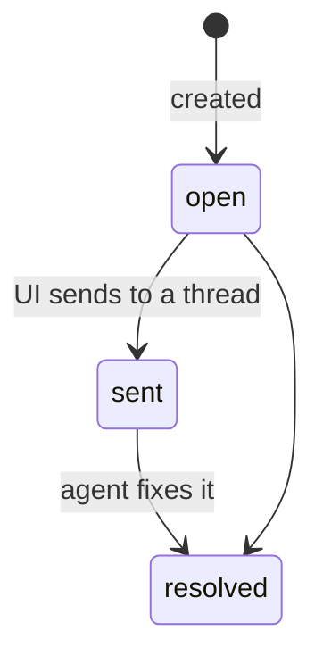
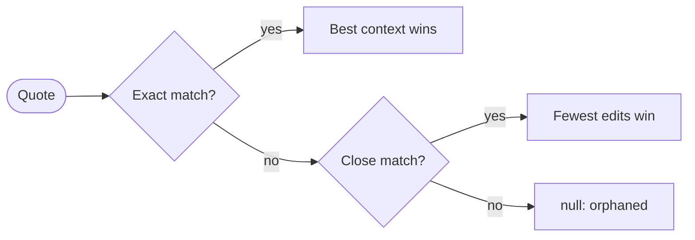
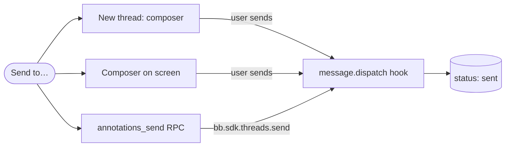

# Annotations

An *annotation* is the stored record of one comment. It points at a place in
a space file, and it stays at that place when the file changes. This page is
the contract for the Review tab, *Send to…* and the agent CLI. The reason
for annotations is in the [decision](../decisions/annotations.md).

> [!NOTE] Built for all file types
> The model, anchors, storage and RPC (T10); comments on Markdown pages
> (T30); the Review tab with *Send to…* (T31); `bb space annotations` and the
> `space_annotations` tool (T32); comments on canvases (T33) and on HTML
> pages (T34).

| Part | Where |
| --- | --- |
| model and anchors (pure, for the server and the app) | [`lib/annotations.ts`](../../lib/annotations.ts) |
| storage, RPC, moves of files | [`server/annotations.ts`](../../server/annotations.ts) |
| Markdown reader: selection, highlights, the comment popover | [`ui/annotate/markdown.tsx`](../../ui/annotate/markdown.tsx); rendered text ⇄ DOM in [`ui/annotate/text.ts`](../../ui/annotate/text.ts) |
| canvases: *Comment* on a selection, badges, orphans | [`ui/annotate/tldraw.tsx`](../../ui/annotate/tldraw.tsx) |
| HTML pages: *Annotate* mode over the sandboxed frame | [`ui/annotate/html.tsx`](../../ui/annotate/html.tsx); the script in the frame is [`ui/annotate/html-bridge.ts`](../../ui/annotate/html-bridge.ts) |
| the editor and card of the popover, for all three | [`ui/annotate/comment.tsx`](../../ui/annotate/comment.tsx) |
| Review tab and *Send to…* | [`ui/ReviewTab.tsx`](../../ui/ReviewTab.tsx); groups and the message in [`lib/review.ts`](../../lib/review.ts) |
| sending and marking as sent | [`server/send.ts`](../../server/send.ts) |
| `bb space annotations` and the `space_annotations` tool | [`server/annotations-agent.ts`](../../server/annotations-agent.ts); their output text in [`lib/annotation-text.ts`](../../lib/annotation-text.ts) |
| canvas comments as text for agents | [`lib/canvas/read.ts`](../../lib/canvas/read.ts) (`describeTldr`) |
| tests | `test/annotations.test.ts`, `test/annotations-store.test.ts`, `test/annotate-text.test.ts`, `test/review.test.ts`, `test/send.test.ts`, `test/annotations-agent.test.ts`, `test/canvas-read.test.ts`, `test/html-bridge.test.ts` |
| live checks | `scripts/e2e/annotations.mjs`, `scripts/e2e/annotations-markdown.mjs`, `scripts/e2e/annotations-canvas.mjs`, `scripts/e2e/annotations-html.mjs`, `scripts/e2e/review.mjs`, `scripts/e2e/annotations-agent.mjs` |

## The model

```ts
type Anchor =
  | { kind: "text-quote"; exact: string; prefix: string; suffix: string } // md, html, text
  | { kind: "shapes"; shapeIds: string[] }                                  // tldraw
  | { kind: "file" };                                                       // whole file

interface Annotation {
  id: string;            // "ann_" + 12 base-36 chars
  path: string;          // space-relative file
  anchor: Anchor;
  comment: string;       // 1–4000 chars (MAX_COMMENT_LENGTH)
  status: "open" | "sent" | "resolved";
  author: "user" | "agent";
  createdAt: number; updatedAt: number;   // ms since epoch
  sentTo?: { threadId: string; at: number };
  resolution?: string;   // the agent's reply, then its note when resolving
}
```

A new annotation has the status `open`. The diagram shows the usual life
cycle. **Nothing enforces these transitions.** The UI sets `open → sent` when
it sends, and the agent sets `resolved`.



## How text is anchored

`quoteSelector(text, start, end)` returns `{ exact, prefix, suffix }`. The
prefix and the suffix have 32 characters (`QUOTE_CONTEXT`) each, or fewer at
the start and end of the text. `text` is the text that the view anchors
against. When the view locates the quote later, it must use the same kind of
text. Markdown and HTML pages both use the **rendered text**, not the
source. Thus a quote never contains Markdown syntax.

`locateQuote(text, selector)` returns `{ start, end }` or `null`. It tries
three steps in order:



1. **Exact.** If `exact` occurs once, that match wins. If it occurs more than
   once, each match gets a score: the number of `prefix` characters directly
   before it and `suffix` characters directly after it.
2. **Fuzzy.** An approximate search (edit distance, Sellers' algorithm)
   accepts a match with edits of 30 % of the length of `exact` or fewer. The
   match with the fewest edits wins, then the best context. The search does
   not run for quotes shorter than 8 characters or for very large texts
   (more than 50 M DP cells).
3. **Null.** The quote is gone. The UI shows the annotation as *orphaned*
   and keeps it.

The canvas resolves shape anchors: if all ids are missing, the annotation is
orphaned (see [Canvases](#canvases)). A `file` anchor always resolves.

## Markdown pages

The reader ([`ui/annotate/markdown.tsx`](../../ui/annotate/markdown.tsx))
wraps `MarkdownView` only while the page is in read mode, never in edit
mode.

- **Rendered text** — the text nodes of the article, joined in order. This
  is its `textContent` without the plugin's own UI in it (marked
  `data-annotate-skip`). [`ui/annotate/text.ts`](../../ui/annotate/text.ts)
  changes DOM selections into offsets in that text, and offsets back into
  `Range`s.
- **New comment** — a selection in the article that is not empty shows
  *Comment*. The popover saves `quoteSelector(text, start, end)` without the
  whitespace around it.
- **Highlights** — after each render, the reader locates each `text-quote`
  annotation with `locateQuote`. A `MutationObserver` on the article also
  sees code blocks and diagrams that render later. The reader paints the
  ranges with the CSS Custom Highlight API: `space-annotation`,
  `space-annotation-resolved`, and `space-annotation-active` for the open
  comment. It adds these CSS rules at runtime, because the CSS optimizer of
  the build warns on `::highlight()`. The reader does not change the DOM of
  the page. If the browser has no Highlight API, the reader wraps the ranges
  in `<mark data-annotation-mark>` and removes them before the next pass.
- **Open** — if a click is in the client rects of a highlight, it opens that
  comment. If highlights overlap, the shortest one wins. Links and buttons
  keep their own clicks.
- **Under the title** — `MarkdownView`'s `titleSlot` renders directly after
  the first top-level `# heading`, or at the top if there is no such
  heading. It lists orphaned annotations (quote not found, or a `shapes`
  anchor) and `file` anchors.
- **Live** — `useAnnotations` in [`ui/data.ts`](../../ui/data.ts) fetches
  again on `space-annotations-changed` for the page and on a reconnect.

## Canvases

[`ui/annotate/tldraw.tsx`](../../ui/annotate/tldraw.tsx) draws the comments
of a canvas over the canvas. The component slots of tldraw take no props. So
`TldrawView` wraps `<Tldraw>` in `<CanvasAnnotations>`, which holds the
annotations of the file (`useAnnotations`) and the open popover. It then
passes `canvasAnnotationComponents`, whose slots read that context.

- **New comment** — while shapes are selected and the select tool is idle,
  a *Comment* button shows below the bounds of the selection. The context
  menu of tldraw also gets a *Comment* item (`ContextMenu` slot). Both save
  `{ kind: "shapes", shapeIds }` with the selected ids.
- **Badges** — in the `InFrontOfTheCanvas` slot. ==A `useValue` calculates
  the position of each comment from the signals of the editor.== Thus the
  badges render again when the camera or a shape moves. The position is the
  union of the page bounds of the comment's shapes on the current page.
  `pageToViewport` changes it into viewport pixels, and the badge goes on
  its top-right corner. Badges on the same corner go in a line to the left.
  The number is the position of the comment in the list of the file's
  comments, oldest first.
- **Open** — a click on a badge opens the shared `CommentCard` in an
  `EditorPortal` above the panels of tldraw. A dashed frame shows around the
  shapes.
- **Orphans** — if all shapes of a comment are gone, the top-left corner
  lists the comment (*comments whose shapes are gone*). The same list shows
  `file` and `text-quote` anchors as *comments on the whole canvas*. Shapes
  on a different tldraw page are not drawn and not listed.
- **Not before the load** — `ready` stays false until `TldrawView` has
  loaded the file, and while it cannot load the file. Thus an empty canvas
  during the load does not list all comments as orphaned.
- **Review tab** — a focus request moves the camera to the shapes and opens
  the comment.

The shape ids from `space_draw` come from the node ids (`shape:node-<id>`).
Thus, if an agent draws the same nodes again, also with `clear: true`, the
comments stay on them.

## HTML pages

An HTML page runs in a sandbox without `allow-same-origin`. Thus bb cannot
read or mark its DOM. ==Comments on HTML pages go through a bridge script,
and only *Annotate* mode adds it.== The plain view stays the bare preview
URL. The messages and the security rules are in
[Architecture → The annotation bridge](index.md#the-annotation-bridge).

- **Annotate mode** — the *Annotate* button in the toolbar makes `HtmlFrame`
  render the saved file through `srcdoc`. The `<base href>` points to the
  preview URL, and the bridge is first in `<head>`. The scripts of the page
  run as usual. The mode applies to one view and is off by default.
- **Rendered text** — the bridge joins the text nodes under `<body>`. It
  skips `<script>`, `<style>`, `<noscript>` and `<template>`. It posts the
  text after each change: a `MutationObserver` with a throttle of 150 ms.
  Thus a page that changes all the time still sends its text.
- **New comment** — on a trusted `mouseup` or `keyup` with a selection that
  is not empty, the bridge posts the quote. It removes the whitespace around
  the quote and adds 32 characters of context. bb shows *Comment* next to
  the selection. The popover is the same as in the Markdown reader.
- **Highlights** — bb locates each `text-quote` annotation in the reported
  text with `locateQuote`, so the fuzzy match works as on Markdown pages. bb
  sends the offsets back. The bridge paints them with the CSS Custom
  Highlight API, with the same names and colors as the reader. The offsets
  apply to the text that the bridge sent last. Thus the bridge maps them
  through the text nodes of that text, not through the live DOM. There is no
  `<mark>` fallback, because the Chromium of bb has the API.
- **Open** — a trusted click in the rects of a highlight posts `click`. If
  highlights overlap, the shortest one wins. Links, buttons and form fields
  keep their own clicks. When the focus moves into the frame, an open
  comment closes.
- **Above the frame** — a strip above the page lists orphaned comments and
  `file` anchors.
- **Review tab** — a focus request turns *Annotate* on. The bridge scrolls
  the passage into view and reports its position. This opens the comment.

## Review and *Send to…*

The Review tab shows `annotations_list` for the full project
(`useProjectAnnotations`, live on `space-annotations-changed`).
`reviewGroups` puts the comments in groups by file. In a file, open comments
come first, then sent, then resolved, and the oldest first in each group.
Files with open comments come first. A click on a comment opens its file and
calls `requestAnnotationFocus`. When the page has rendered, the Markdown
reader reads this request, scrolls to the passage and opens the comment.

*Send to…* takes the ticked comments (by default, all open comments) to one
of three places. `reviewMessage` makes the same text for all three:

```text
Review of the project space — 2 comments.
1. architecture/index.md — «exact quote» → comment  [ann_…]
2. roadmap.md → comment about the whole file  [ann_…]
Resolve each with `bb space annotations resolve <id> --note "…"` when done.
```



| Destination | How |
| --- | --- |
| New thread | `useBbNavigate().toCompose({ initialPrompt })` |
| Composer on screen | `useComposers()` → `composer.insert(…)` |
| Thread of this project | RPC `annotations_send({ projectId, ids, threadId })` → `bb.sdk.threads.send` (mode `auto`) |

Only the RPC knows its thread before the send. Thus one place marks the
comments for all three destinations: a `message.dispatch` hook. The hook
reads the ids back with `annotationIdsIn`, only after the header
`Review of the project space`. It sets `status: "sent"` and
`sentTo: { threadId, at }`. Resolved comments stay resolved. A second send
to the same thread writes nothing. The hook always lets the message go and
never throws, so it cannot block a send.

## For agents

The agent finishes the review with `bb space annotations` or the
`space_annotations` tool. Both use the same store as the RPC and publish
`space-annotations-changed`. Thus the Review tab and the reader update live.

| Command | Tool action | Does |
| --- | --- | --- |
| `list [--path p] [--status s] [--json]` | `list` (`path?`, `status?`) | prints one line for each annotation, in the order of the Review tab: `id  status  path — «quote» → comment` |
| `show <id>` | `show` (`id`) | prints the comment, a reply if there is one, the anchor, and for a quote its lines in the file **as the file is now** (`locateQuote`), with 3 lines on each side; `>` marks the lines of the quote |
| `resolve <id> [--note "…"]` | `resolve` (`id`, `note?`) | sets `status: "resolved"` and `resolution` to the note; without a note, an earlier reply stays |
| `reply <id> "…"` | — | sets `resolution` and does not change the status, for a question back to the user |

- **Limits** — each output stays below 60 KB (`MAX_OUTPUT_BYTES`). `list`
  cuts quote and comment to 160 characters on each line. If it cuts lines,
  it ends with `… N more not shown`. `--json` gives
  `{ annotations, total, truncated }` with as many full annotations as fit.
  `show` cuts the comment and the quote to 4000 characters and each context
  line to 400.
- **Orphans** — if the quote is not in the file now, `show` says so and
  prints no context. For shape anchors, it points to
  `bb space canvas <path>`.
- **Canvases** — `describeTldr` takes the annotations of the file. Thus
  `bb space canvas`, `space_canvas_read` and the `space_draw` result print
  each open or sent comment under the first shape that it points at:
  `↳ comment ann_… [open] (also on db): "…"`, cut to 300 characters. A
  last *Comments* section lists the other comments: comments on shapes
  that are gone or only counted (hand-drawn), and `file` anchors. It counts
  the resolved comments. If an annotation file cannot be read or parsed, the
  output adds a note and the read does not fail. Only a missing file (HTTP
  404 from `bb.sdk.files`) means "no comments". The output reports all
  other read errors and never shows them as "no comments".
- **Errors** — an unknown id fails with `No annotation <id>` (code
  `annotation_not_found`).

## Where annotations are stored

There is one JSON file for each file with comments, in the hidden folder of
the space:

```text
.bb-space/.space/annotations/<path>.json   →   { "version": 1, "annotations": [ … ] }
```

- **Concurrent writers** — each write is read → change →
  `bb.sdk.files.write` with `expectedSha256` (null for a new file). On a
  conflict, the write tries again, 5 times or fewer. Thus two windows and an
  agent never lose the changes of the others.
- **The location wins** — a read replaces the stored `path` with the path
  that comes from the file name.
- **Search by id** — the server reads the annotation files to find an id.
  This is fast enough for the hundreds of annotations in a space.
- **Empty files** (`annotations: []`) stay after the last delete. They list
  as nothing.

> [!WARNING] Repair or delete a broken annotation file
> If a file does not parse, each call that reads it fails. The error message
> names the file.

## Moves and removes

`space_move` and `space_remove` ([`server/files.ts`](../../server/files.ts))
call `followFileChange` after the file operation:

| Operation | Result for the annotation files at or under the path |
| --- | --- |
| move (file or folder) | written again at the new path and merged with a file that is already there; the old file is removed |
| remove (file or folder) | deleted |

The server logs failures and does not throw, because the file operation is
already done.

> [!WARNING] Move files in the app, not with `mv`
> An agent's `mv` or a `git mv` leaves the annotations at the old path. The
> UI can then show them as comments on a missing file.

## RPC

All inputs have `projectId`. Paths are relative to the space and must not
point into `.space/`. An unknown id throws `No annotation <id>`.

| Method | Input | Output |
| --- | --- | --- |
| `annotations_list` | `path?` (all files if not given) | `{ annotations }`, oldest first |
| `annotations_create` | `path, anchor, comment, author?` (default `"user"`) | `{ annotation }` |
| `annotations_update` | `id, comment?, status?, resolution?, sentTo?` | `{ annotation }` |
| `annotations_delete` | `id` | `{ ok: true }` |
| `annotations_send` | `ids, threadId` (a thread of this project; 200 ids or fewer) | `{ sent, text }` |

To call the RPC from a shell:

```sh
echo '{"projectId":"'$BB_PROJECT_ID'","path":"index.md","anchor":{"kind":"file"},"comment":"Tighten the intro"}' > /tmp/a.json
bb plugin rpc call project-space annotations_create --input-file /tmp/a.json --json
```

## Realtime

After each write, the server publishes `space-annotations-changed` with
`{ projectId, path }`, once for each changed file. A move publishes both
paths. The writes also go into `.bb-space/`, so the watcher also publishes
`space-changed`. A view that needs only annotations must listen to the
specific channel.
