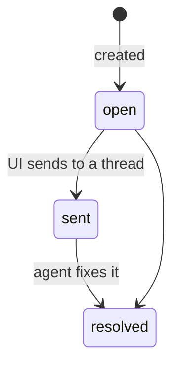

# Annotations

An *annotation* is a comment pinned to a place in a space file that survives
edits to that file. This page is the contract the Review tab, *Send to…* and
the agent CLI build on (T30–T34); why annotations exist is in the
[decision](../decisions/annotations.md).

> [!NOTE] Built: every file type
> Model, anchoring, storage and RPC (T10), annotating Markdown pages in the
> reader (T30), the Review tab with *Send to…* (T31),
> `bb space annotations` with the `space_annotations` tool (T32),
> annotating canvases (T33) and HTML pages (T34).

| Piece | Where |
| --- | --- |
| model and anchoring (pure, shared by server and app) | [`lib/annotations.ts`](../../lib/annotations.ts) |
| storage, RPC, following moves | [`server/annotations.ts`](../../server/annotations.ts) |
| Markdown reader: selecting, highlights, the comment popover | [`ui/annotate/markdown.tsx`](../../ui/annotate/markdown.tsx), rendered text ↔ DOM in [`ui/annotate/text.ts`](../../ui/annotate/text.ts) |
| canvases: *Comment* on a selection, badges, orphans | [`ui/annotate/tldraw.tsx`](../../ui/annotate/tldraw.tsx) |
| HTML pages: *Annotate* mode over the sandboxed frame | [`ui/annotate/html.tsx`](../../ui/annotate/html.tsx); the script inside the frame in [`ui/annotate/html-bridge.ts`](../../ui/annotate/html-bridge.ts) |
| the popover's editor and card, shared by all three | [`ui/annotate/comment.tsx`](../../ui/annotate/comment.tsx) |
| Review tab and *Send to…* | [`ui/ReviewTab.tsx`](../../ui/ReviewTab.tsx); grouping and the message in [`lib/review.ts`](../../lib/review.ts) |
| sending and marking sent | [`server/send.ts`](../../server/send.ts) |
| `bb space annotations` and the `space_annotations` tool | [`server/annotations-agent.ts`](../../server/annotations-agent.ts); the text they print in [`lib/annotation-text.ts`](../../lib/annotation-text.ts) |
| canvas comments as text for agents | [`lib/canvas/read.ts`](../../lib/canvas/read.ts) (`describeTldr`) |
| tests | `test/annotations.test.ts`, `test/annotations-store.test.ts`, `test/annotate-text.test.ts`, `test/review.test.ts`, `test/send.test.ts`, `test/annotations-agent.test.ts`, `test/canvas-read.test.ts`, `test/html-bridge.test.ts` |
| live checks | `scripts/e2e/annotations.mjs`, `scripts/e2e/annotations-markdown.mjs`, `scripts/e2e/annotations-canvas.mjs`, `scripts/e2e/annotations-html.mjs`, `scripts/e2e/review.mjs`, `scripts/e2e/annotations-agent.mjs` |

## The model

```ts
type Anchor =
  | { kind: "text-quote"; exact: string; prefix: string; suffix: string } // md, html, text
  | { kind: "shapes"; shapeIds: string[] }                                  // tldraw
  | { kind: "file" };                                                       // whole file

interface Annotation {
  id: string;            // "ann_" + 12 base-36 chars
  path: string;          // space-relative file
  anchor: Anchor;
  comment: string;       // 1–4000 chars (MAX_COMMENT_LENGTH)
  status: "open" | "sent" | "resolved";
  author: "user" | "agent";
  createdAt: number; updatedAt: number;   // ms since epoch
  sentTo?: { threadId: string; at: number };
  resolution?: string;   // the agent's reply, then its note when resolving
}
```

New annotations start `open`. The intended life cycle is below, but
**nothing enforces the transitions**: the UI moves `open → sent` when it
sends, the agent moves to `resolved`.



## How text is anchored

`quoteSelector(text, start, end)` returns `{ exact, prefix, suffix }` with 32
characters (`QUOTE_CONTEXT`) of context on each side, clamped at the ends.
`text` is whatever the viewer anchors against and must be the same kind when
locating. Markdown and HTML pages both anchor against the **rendered text**,
not the source, so a quote never contains Markdown syntax.

`locateQuote(text, selector)` returns `{ start, end }` or `null`, trying in
order:

1. **Exact.** One occurrence of `exact` wins. Several are ranked by how many
   characters of `prefix` end right before and of `suffix` start right after
   each.
2. **Fuzzy.** An approximate search (edit distance, Sellers' algorithm)
   accepts matches with at most 30 % of `exact`'s length in edits; fewest
   edits wins, then context. Skipped for quotes under 8 characters and for
   very large texts (> 50 M DP cells).
3. **Null.** The quote is gone; the UI shows the annotation as *orphaned* and
   keeps it.

Shape anchors are resolved by the canvas (all ids missing → orphaned, see
[Canvases](#canvases)); `file` anchors always resolve.

## Markdown pages

The reader ([`ui/annotate/markdown.tsx`](../../ui/annotate/markdown.tsx))
wraps `MarkdownView` only while the page is read, never while it is edited.

- **Rendered text** — the article's text nodes joined in order, which is its
  `textContent` minus the plugin's own UI inside it (marked
  `data-annotate-skip`). [`ui/annotate/text.ts`](../../ui/annotate/text.ts)
  maps DOM selections to offsets in that text and offsets back to `Range`s.
- **Creating** — a non-empty selection inside the article shows *Comment*;
  the popover saves `quoteSelector(text, start, end)` with surrounding
  whitespace trimmed.
- **Highlights** — after every render (a `MutationObserver` on the article
  also catches code blocks and diagrams that fill in later) each `text-quote`
  annotation is located with `locateQuote` and painted with the CSS Custom
  Highlight API: `space-annotation`, `space-annotation-resolved`, and
  `space-annotation-active` for the open one (the rules are injected at
  runtime: the build's CSS optimizer warns on `::highlight()`). The page's DOM is not touched. Without that API
  the ranges are wrapped in `<mark data-annotation-mark>` and unwrapped
  before the next pass.
- **Opening** — a click whose point falls inside a highlight's client rects
  opens that comment (the shortest of overlapping ones); links and buttons
  keep their own clicks.
- **Under the title** — `MarkdownView`'s `titleSlot` renders right after the
  first top-level `# heading` (at the top when there is none). It lists
  orphaned annotations (quote not found, or a `shapes` anchor) and `file`
  anchors.
- **Live** — `useAnnotations` in [`ui/data.ts`](../../ui/data.ts) refetches
  on `space-annotations-changed` for the page and on reconnect.

## Canvases

[`ui/annotate/tldraw.tsx`](../../ui/annotate/tldraw.tsx) draws a canvas's
comments over the board. tldraw's component slots take no props, so
`TldrawView` wraps `<Tldraw>` in `<CanvasAnnotations>` (the file's
annotations via `useAnnotations`, and which popover is open) and passes
`canvasAnnotationComponents`, whose slots read that context.

- **Creating** — while shapes are selected and the select tool is idle, a
  *Comment* button sits under the selection's bounds; tldraw's context menu
  gets a *Comment* item too (`ContextMenu` slot). Both save
  `{ kind: "shapes", shapeIds }` with the selected ids.
- **Badges** — in the `InFrontOfTheCanvas` slot. ==A `useValue` computes each
  comment's place from the editor's signals==, so badges re-render when the
  camera or a shape moves. The place is the union page bounds of the shapes
  that exist on the current page, turned into viewport pixels with
  `pageToViewport`; the badge sits on its top-right corner. Badges on the
  same corner line up leftwards. The number is the comment's position among
  the file's comments, oldest first.
- **Opening** — a badge opens the shared `CommentCard` in an `EditorPortal`
  above tldraw's panels, with a dashed frame round the shapes.
- **Orphans** — a comment whose shapes are all gone is listed in the
  top-left corner (*comments whose shapes are gone*), with `file` and
  `text-quote` anchors as *comments on the whole canvas*. Shapes that exist
  on another tldraw page are neither drawn nor listed.
- **Not before the load** — `ready` is false until `TldrawView` has loaded
  the file, and while it cannot load it, so a board that is still empty
  does not list everything as orphaned.
- **Review tab** — a focus request centers the camera on the shapes and
  opens the comment.

Shape ids from `space_draw` derive from node ids (`shape:node-<id>`), so a
redraw of the same nodes, even with `clear: true`, keeps the comments on
them.

## HTML pages

An HTML page runs in a sandbox without `allow-same-origin`, so bb cannot
read or mark its DOM. ==Comments on it go through a bridge script that only
*Annotate* mode injects==; the plain view stays the bare preview URL. The
messages and the security rules are in
[Architecture → The annotation bridge](index.md#the-annotation-bridge).

- **Annotate mode** — the *Annotate* toggle in the toolbar makes
  `HtmlFrame` render the saved file through `srcdoc`, with `<base href>` on
  the preview URL and the bridge first in `<head>`. The page's own scripts
  run as usual. The toggle is per view and off by default.
- **Rendered text** — the bridge joins the text nodes under `<body>`,
  skipping `<script>`, `<style>`, `<noscript>` and `<template>`, and posts
  it whenever it changes (a `MutationObserver`, throttled to once every
  150 ms, so a page that never stops changing still sends its text).
- **Creating** — on a trusted `mouseup`/`keyup` with a non-empty selection
  the bridge posts the quote, trimmed of whitespace, with 32 characters of
  context. bb shows *Comment* by the selection; the popover is the
  Markdown reader's.
- **Highlights** — bb locates every `text-quote` annotation in the reported
  text with `locateQuote` (so fuzzy matching works as on Markdown pages) and
  sends the offsets back. The bridge paints them with the CSS Custom
  Highlight API, same names and colors as the reader. The offsets are into
  the text last sent, so the bridge maps them through the text nodes of that
  text, not the live DOM. There is no `<mark>` fallback: bb's Chromium has
  the API.
- **Opening** — a trusted click inside a highlight's rects (the shortest of
  overlapping ones) posts `click`; links, buttons and form fields keep their
  own clicks. Focus moving into the frame closes an open comment.
- **Above the frame** — orphaned comments and `file` anchors are listed in a
  strip over the page.
- **Review tab** — a focus request switches *Annotate* on; the bridge
  scrolls the passage into view and reports where it is, which opens the
  comment.

## Review and *Send to…*

The Review tab lists `annotations_list` for the whole project
(`useProjectAnnotations`, live on `space-annotations-changed`), grouped by
`reviewGroups`: open, then sent, then resolved inside a file, oldest first;
files with open comments first. Clicking a comment navigates to its file and
calls `requestAnnotationFocus`, which the Markdown reader picks up once the
page has rendered to scroll to the passage and open its comment.

*Send to…* takes the ticked comments (by default every open one) to one of
three places. `reviewMessage` builds the same text for all three:

```text
Review of the project space — 2 comments.
1. architecture/index.md — «exact quote» → comment  [ann_…]
2. roadmap.md → comment about the whole file  [ann_…]
Resolve each with `bb space annotations resolve <id> --note "…"` when done.
```

| Destination | How |
| --- | --- |
| New thread | `useBbNavigate().toCompose({ initialPrompt })` |
| Composer on screen | `useComposers()` → `composer.insert(…)` |
| Thread of this project | RPC `annotations_send({ projectId, ids, threadId })` → `bb.sdk.threads.send` (mode `auto`) |

Only the RPC knows its thread up front, so marking is done in one place for
all three: a `message.dispatch` hook reads the ids back with
`annotationIdsIn` (only after the `Review of the project space` header) and
sets `status: "sent"` and `sentTo: { threadId, at }`. Resolved comments stay
resolved; a re-dispatch to the same thread writes nothing. The hook always
proceeds and never throws, so it can't block a send.

## For agents

The agent closes the loop with `bb space annotations` or the
`space_annotations` tool. Both read and write through the same store as the
RPC and publish `space-annotations-changed`, so the Review tab and the
reader update live.

| Command | Tool action | Does |
| --- | --- | --- |
| `list [--path p] [--status s] [--json]` | `list` (`path?`, `status?`) | one line per annotation in the Review tab's order: `id  status  path — «quote» → comment` |
| `show <id>` | `show` (`id`) | the comment, any reply, the anchor, and for a quote its lines in the file **as it reads now** (`locateQuote`), with 3 lines either side, the quote's lines marked `>` |
| `resolve <id> [--note "…"]` | `resolve` (`id`, `note?`) | `status: "resolved"`, `resolution` = the note; without one an earlier reply is kept |
| `reply <id> "…"` | — | sets `resolution` and leaves the status alone, for a question back to the user |

- **Bounded** — every output stays under 60 KB (`MAX_OUTPUT_BYTES`): list
  lines clip quote and comment to 160 characters and end with
  `… N more not shown` when cut; `--json` gives `{ annotations, total,
  truncated }` with as many whole annotations as fit; `show` clips the
  comment and the quote to 4000 characters and each context line to 400.
- **Orphans** — when the quote is no longer found, `show` says so instead of
  printing context. Shape anchors point at `bb space canvas <path>`.
- **Canvases** — `describeTldr` takes the file's annotations, so
  `bb space canvas`, `space_canvas_read` and the `space_draw` result print
  each open or sent comment under the first described shape it points at
  (`↳ comment ann_… [open] (also on db): "…"`, clipped to 300 characters).
  Comments on shapes that are gone or only counted (hand-drawn), and `file`
  anchors, go to a closing *Comments* section; resolved ones are counted. An
  annotation file that cannot be read or parsed adds a note instead of
  failing the read. Only a missing file (HTTP 404 from `bb.sdk.files`) means
  "no comments"; any other read error is reported, never shown as none.
- **Errors** — an unknown id fails with `No annotation <id>` (code
  `annotation_not_found`).

## Where annotations are stored

One JSON file per annotated file, in the space's hidden bookkeeping folder:

```text
.bb-space/.space/annotations/<path>.json   →   { "version": 1, "annotations": [ … ] }
```

- **Concurrent writers** — every write is read → modify →
  `bb.sdk.files.write` with `expectedSha256` (null when creating), retried up
  to 5 times on conflict, so two windows and an agent never lose each other's
  changes.
- **Location wins** — reads overwrite the stored `path` with the one derived
  from the file name.
- **Lookup by id** scans the annotation files; fine for the hundreds a space
  holds.
- **Empty files** (`annotations: []`) stay after the last delete and list as
  nothing.

> [!WARNING] A broken annotation file blocks its calls
> A file that fails to parse makes every call touching it fail, with a
> message naming the file to fix or delete.

## Following moves and removes

`space_move` and `space_remove` ([`server/files.ts`](../../server/files.ts))
call `followFileChange` after the file operation:

| Operation | What happens to annotation files at or under the path |
| --- | --- |
| move (file or folder) | re-written at the new path, merged with any already there; the old one removed |
| remove (file or folder) | deleted |

Failures are logged, not thrown — the file operation already happened.

> [!WARNING] Moves outside the app are not followed
> An agent's `mv` or a `git mv` leaves the annotations under the old path;
> the UI can show them as belonging to a missing file.

## RPC

All inputs carry `projectId`. Paths are space-relative and may not point into
`.space/`. Unknown ids throw `No annotation <id>`.

| Method | Input | Output |
| --- | --- | --- |
| `annotations_list` | `path?` (all files when omitted) | `{ annotations }`, oldest first |
| `annotations_create` | `path, anchor, comment, author?` (default `"user"`) | `{ annotation }` |
| `annotations_update` | `id, comment?, status?, resolution?, sentTo?` | `{ annotation }` |
| `annotations_delete` | `id` | `{ ok: true }` |
| `annotations_send` | `ids, threadId` (a thread of this project; at most 200 ids) | `{ sent, text }` |

From a shell:

```sh
echo '{"projectId":"'$BB_PROJECT_ID'","path":"index.md","anchor":{"kind":"file"},"comment":"Tighten the intro"}' > /tmp/a.json
bb plugin rpc call project-space annotations_create --input-file /tmp/a.json --json
```

## Realtime

`space-annotations-changed` with `{ projectId, path }` is published after
every write, once per affected file (both paths on a move). The writes also
land inside `.bb-space/`, so the watcher's `space-changed` fires too; views
that only care about annotations should listen to the specific channel.
