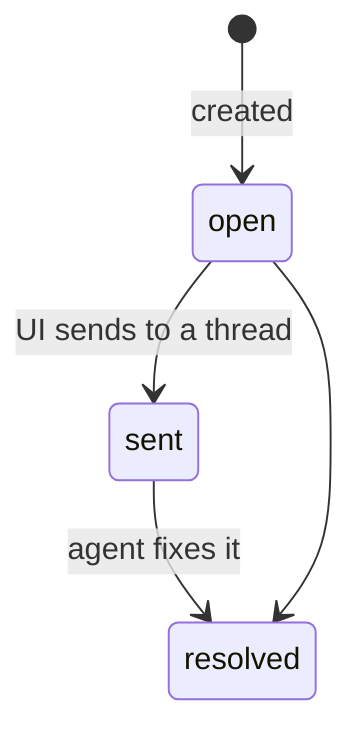

# Annotations

An *annotation* is a comment pinned to a place in a space file that survives
edits to that file. This page is the contract the Review tab, *Send to…* and
the agent CLI build on (T30–T34); why annotations exist is in the
[decision](../decisions/annotations.md).

> [!NOTE] Built so far: the data layer and Markdown pages
> Model, anchoring, storage and RPC (T10), and annotating Markdown pages in
> the reader (T30). The Review tab, HTML, canvases and the agent command are
> still to come — see the [roadmap](../roadmap.md).

| Piece | Where |
| --- | --- |
| model and anchoring (pure, shared by server and app) | [`lib/annotations.ts`](../../lib/annotations.ts) |
| storage, RPC, following moves | [`server/annotations.ts`](../../server/annotations.ts) |
| Markdown reader: selecting, highlights, the comment popover | [`ui/annotate/markdown.tsx`](../../ui/annotate/markdown.tsx), rendered text ↔ DOM in [`ui/annotate/text.ts`](../../ui/annotate/text.ts) |
| tests | `test/annotations.test.ts`, `test/annotations-store.test.ts`, `test/annotate-text.test.ts` |
| live checks | `scripts/e2e/annotations.mjs`, `scripts/e2e/annotations-markdown.mjs` |

## The model

```ts
type Anchor =
  | { kind: "text-quote"; exact: string; prefix: string; suffix: string } // md, html, text
  | { kind: "shapes"; shapeIds: string[] }                                  // tldraw
  | { kind: "file" };                                                       // whole file

interface Annotation {
  id: string;            // "ann_" + 12 base-36 chars
  path: string;          // space-relative file
  anchor: Anchor;
  comment: string;       // 1–4000 chars (MAX_COMMENT_LENGTH)
  status: "open" | "sent" | "resolved";
  author: "user" | "agent";
  createdAt: number; updatedAt: number;   // ms since epoch
  sentTo?: { threadId: string; at: number };
  resolution?: string;   // agent's note when resolving
}
```

New annotations start `open`. The intended life cycle is below, but
**nothing enforces the transitions**: the UI moves `open → sent` when it
sends, the agent moves to `resolved`.



## How text is anchored

`quoteSelector(text, start, end)` returns `{ exact, prefix, suffix }` with 32
characters (`QUOTE_CONTEXT`) of context on each side, clamped at the ends.
`text` is whatever the viewer anchors against and must be the same kind when
locating. Markdown and HTML pages both anchor against the **rendered text**,
not the source, so a quote never contains Markdown syntax.

`locateQuote(text, selector)` returns `{ start, end }` or `null`, trying in
order:

1. **Exact.** One occurrence of `exact` wins. Several are ranked by how many
   characters of `prefix` end right before and of `suffix` start right after
   each.
2. **Fuzzy.** An approximate search (edit distance, Sellers' algorithm)
   accepts matches with at most 30 % of `exact`'s length in edits; fewest
   edits wins, then context. Skipped for quotes under 8 characters and for
   very large texts (> 50 M DP cells).
3. **Null.** The quote is gone; the UI shows the annotation as *orphaned* and
   keeps it.

Shape anchors are resolved by the canvas (missing ids → orphaned); `file`
anchors always resolve.

## Markdown pages

The reader ([`ui/annotate/markdown.tsx`](../../ui/annotate/markdown.tsx))
wraps `MarkdownView` only while the page is read, never while it is edited.

- **Rendered text** — the article's text nodes joined in order, which is its
  `textContent` minus the plugin's own UI inside it (marked
  `data-annotate-skip`). [`ui/annotate/text.ts`](../../ui/annotate/text.ts)
  maps DOM selections to offsets in that text and offsets back to `Range`s.
- **Creating** — a non-empty selection inside the article shows *Comment*;
  the popover saves `quoteSelector(text, start, end)` with surrounding
  whitespace trimmed.
- **Highlights** — after every render (a `MutationObserver` on the article
  also catches code blocks and diagrams that fill in later) each `text-quote`
  annotation is located with `locateQuote` and painted with the CSS Custom
  Highlight API: `space-annotation`, `space-annotation-resolved`, and
  `space-annotation-active` for the open one (the rules are injected at
  runtime: the build's CSS optimizer warns on `::highlight()`). The page's DOM is not touched. Without that API
  the ranges are wrapped in `<mark data-annotation-mark>` and unwrapped
  before the next pass.
- **Opening** — a click whose point falls inside a highlight's client rects
  opens that comment (the shortest of overlapping ones); links and buttons
  keep their own clicks.
- **Under the title** — `MarkdownView`'s `titleSlot` renders right after the
  first top-level `# heading` (at the top when there is none). It lists
  orphaned annotations (quote not found, or a `shapes` anchor) and `file`
  anchors.
- **Live** — `useAnnotations` in [`ui/data.ts`](../../ui/data.ts) refetches
  on `space-annotations-changed` for the page and on reconnect.

## Where annotations are stored

One JSON file per annotated file, in the space's hidden bookkeeping folder:

```text
.bb-space/.space/annotations/<path>.json   →   { "version": 1, "annotations": [ … ] }
```

- **Concurrent writers** — every write is read → modify →
  `bb.sdk.files.write` with `expectedSha256` (null when creating), retried up
  to 5 times on conflict, so two windows and an agent never lose each other's
  changes.
- **Location wins** — reads overwrite the stored `path` with the one derived
  from the file name.
- **Lookup by id** scans the annotation files; fine for the hundreds a space
  holds.
- **Empty files** (`annotations: []`) stay after the last delete and list as
  nothing.

> [!WARNING] A broken annotation file blocks its calls
> A file that fails to parse makes every call touching it fail, with a
> message naming the file to fix or delete.

## Following moves and removes

`space_move` and `space_remove` ([`server/files.ts`](../../server/files.ts))
call `followFileChange` after the file operation:

| Operation | What happens to annotation files at or under the path |
| --- | --- |
| move (file or folder) | re-written at the new path, merged with any already there; the old one removed |
| remove (file or folder) | deleted |

Failures are logged, not thrown — the file operation already happened.

> [!WARNING] Moves outside the app are not followed
> An agent's `mv` or a `git mv` leaves the annotations under the old path;
> the UI can show them as belonging to a missing file.

## RPC

All inputs carry `projectId`. Paths are space-relative and may not point into
`.space/`. Unknown ids throw `No annotation <id>`.

| Method | Input | Output |
| --- | --- | --- |
| `annotations_list` | `path?` (all files when omitted) | `{ annotations }`, oldest first |
| `annotations_create` | `path, anchor, comment, author?` (default `"user"`) | `{ annotation }` |
| `annotations_update` | `id, comment?, status?, resolution?, sentTo?` | `{ annotation }` |
| `annotations_delete` | `id` | `{ ok: true }` |

From a shell:

```sh
echo '{"projectId":"'$BB_PROJECT_ID'","path":"index.md","anchor":{"kind":"file"},"comment":"Tighten the intro"}' > /tmp/a.json
bb plugin rpc call project-space annotations_create --input-file /tmp/a.json --json
```

## Realtime

`space-annotations-changed` with `{ projectId, path }` is published after
every write, once per affected file (both paths on a move). The writes also
land inside `.bb-space/`, so the watcher's `space-changed` fires too; views
that only care about annotations should listen to the specific channel.
