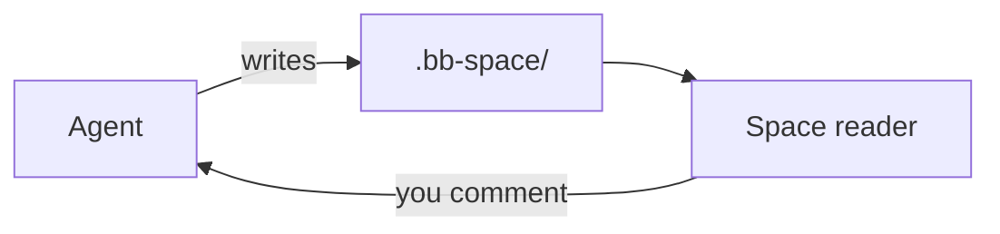

# File formats

| Extension | Opens as | Edited by |
|---|---|---|
| `.md`, `.markdown`, `.mdx` | Rendered document | Source + live preview |
| `.html`, `.htm` | Live page in a sandboxed iframe | Source + live preview |
| `.tldr` | tldraw canvas | tldraw, autosaved |
| `.png`, `.jpg`, `.gif`, `.webp`, `.avif`, `.svg` | Image | — |
| `.pdf` | Browser PDF viewer | — |
| anything else | Highlighted source | Source |

`.tldr` files use tldraw's own file format (`serializeTldrawJson`), so they
also open on [tldraw.com](https://tldraw.com). An empty `.tldr` is a blank
board; the first edit writes the format. Agents draw into them with
`space_draw` / `bb space draw` rather than writing the JSON.

## Mermaid in Markdown

A fenced `mermaid` block in a Markdown page renders as a diagram, in bb's
light or dark theme (it re-renders when the theme flips). Mermaid runs with
`securityLevel: "strict"`: HTML in labels is sanitized (no scripts or event
handlers) and `click` directives are ignored. A block that fails to parse shows mermaid's error line above
the diagram source. This page's own example (open *Source* to see the
fence):

Any diagram type mermaid supports works (`sequenceDiagram`, `classDiagram`,
`stateDiagram-v2`, `erDiagram`, `gantt`, …). Mermaid is bundled into the
Space page but only initialised when a page first contains a diagram.

Dot-prefixed files and folders are hidden from the tree. `.bb-space/.space/`
is reserved for the plugin's own bookkeeping (annotations, later).
