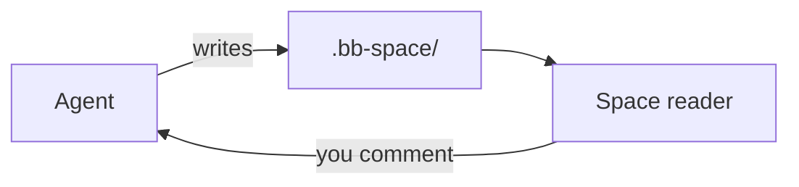

# File formats

| Extension | Opens as | Edited by |
|---|---|---|
| `.md`, `.markdown`, `.mdx` | Rendered document | In place (WYSIWYG), or *Source* + live preview |
| `.html`, `.htm` | Live page in a sandboxed iframe | Source + live preview |
| `.tldr` | tldraw canvas | tldraw, autosaved |
| `.png`, `.jpg`, `.gif`, `.webp`, `.avif`, `.svg` | Image | — |
| `.pdf` | Browser PDF viewer | — |
| anything else | Highlighted source | Source |

`.tldr` files use tldraw's own file format (`serializeTldrawJson`), so they
also open on [tldraw.com](https://tldraw.com). An empty `.tldr` is a blank
board; the first edit writes the format. Agents draw into them with
`space_draw` / `bb space draw` rather than writing the JSON.

## Markdown beyond GFM

Pages are GitHub-flavored Markdown (tables, task lists, strikethrough,
footnotes, autolinks) plus what GitHub and Obsidian readers expect:

| Syntax | Renders as |
|---|---|
| `> [!NOTE]` … `> [!CAUTION]` | GitHub alert: a colored callout with an icon |
| `> [!info] Title`, `> [!bug]- Title` | Obsidian callout with its own title; `-` starts folded, `+` foldable but open |
| `==text==` | highlight (`<mark>`) |
| `[^1]` and `[^1]: …` | footnote; the notes gather at the end of the page |
| `<kbd>`, `<mark>`, `
`/`
`, ``, ``, … | the HTML element |

Callout types fall into GitHub's five colors: *note* (also info, todo,
abstract, summary, tldr), *tip* (hint, success, check, done), *important*
(question, help, faq, example), *warning* (attention), *caution* (danger,
error, failure, bug, missing); `quote` and `cite` are grey, and an unknown
type reads as a note. Parsing lives in
[lib/callouts.ts](../../lib/callouts.ts), the reader's plugins in
[ui/markdown-plugins.ts](../../ui/markdown-plugins.ts).

Raw HTML is sanitized to GitHub's allowlist plus `<mark>`: scripts, styles,
event handlers and `javascript:` links are dropped. Ids from footnotes and raw
HTML get a `user-content-` prefix; in-page `#` links find them either way.

## Mermaid in Markdown

A fenced `mermaid` block in a Markdown page renders as a diagram, in bb's
light or dark theme (it re-renders when the theme flips). Mermaid runs with
`securityLevel: "strict"`: HTML in labels is sanitized (no scripts or event
handlers) and `click` directives are ignored. A block that fails to parse shows mermaid's error line above
the diagram source. This page's own example (open *Source* to see the
fence):

Any diagram type mermaid supports works (`sequenceDiagram`, `classDiagram`,
`stateDiagram-v2`, `erDiagram`, `gantt`, …). Mermaid is bundled into the
Space page but only initialised when a page first contains a diagram.

Dot-prefixed files and folders are hidden from the tree. `.bb-space/.space/`
is reserved for the plugin's own bookkeeping (today: [annotations](annotations.md)).
