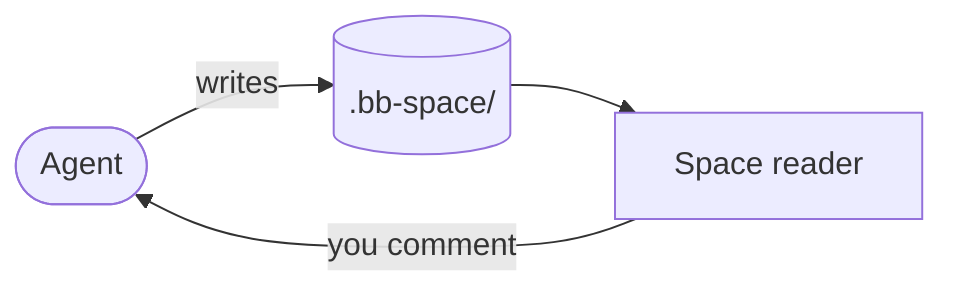

# File formats

What each file in a space opens as, and the Markdown syntax the reader
understands beyond plain GFM. Look things up here; how the reader is built is
in [architecture](index.md).

## What opens as what

| Extension | Opens as | Edited by |
| --- | --- | --- |
| `.md`, `.markdown`, `.mdx` | rendered document | in place (WYSIWYG), or *Source* with a live preview |
| `.html`, `.htm` | live page in a sandboxed iframe | source with a live preview |
| `.tldr` | tldraw canvas | tldraw, autosaved |
| `.png`, `.jpg`, `.gif`, `.webp`, `.avif`, `.svg` | image | — |
| `.pdf` | the browser's PDF viewer | — |
| anything else | highlighted source | source |

`.tldr` files use tldraw's own format (`serializeTldrawJson`), so they also
open on [tldraw.com](https://tldraw.com). An empty `.tldr` is a blank board;
the first edit writes the format. Agents draw into them with `space_draw` /
`bb space draw`, never by writing the JSON.

> [!NOTE] Hidden files
> Dot-prefixed files and folders are hidden from the tree. `.bb-space/.space/`
> is reserved for the plugin's bookkeeping — today, [annotations](annotations.md).

## Markdown beyond GFM

Pages are GitHub-flavored Markdown (tables, task lists, strikethrough,
footnotes, autolinks) plus what GitHub and Obsidian readers expect.

| Syntax | Renders as |
| --- | --- |
| `> [!NOTE]` … `> [!CAUTION]` | GitHub alert: a colored callout with an icon |
| `> [!info] Title`, `> [!bug]- Title` | Obsidian callout with its own title; `-` starts folded, `+` foldable but open |
| `==text==` | highlight (`<mark>`) |
| `[^1]` and `[^1]: …` | footnote; the notes gather at the end of the page |
| `<kbd>`, `<mark>`, `
`/`
`, ``, ``, … | the HTML element |

Callout types fall into GitHub's five colors:

| Color | Types |
| --- | --- |
| *note* (blue) | `note`, `info`, `todo`, `abstract`, `summary`, `tldr`, and any unknown type |
| *tip* (green) | `tip`, `hint`, `success`, `check`, `done` |
| *important* (violet) | `important`, `question`, `help`, `faq`, `example` |
| *warning* (orange) | `warning`, `attention` |
| *caution* (red) | `caution`, `danger`, `error`, `failure`, `bug`, `missing` |
| grey | `quote`, `cite` |

Parsing lives in [lib/callouts.ts](../../lib/callouts.ts), shared by the
reader and the editor; the reader's plugins are in
[ui/markdown-plugins.ts](../../ui/markdown-plugins.ts).

> [!WARNING] Raw HTML is sanitized
> Only GitHub's allowlist plus `<mark>` survives: scripts, `style`, event
> handlers and `javascript:` links are dropped. Ids from footnotes and raw
> HTML get a `user-content-` prefix; in-page `#` links find them either way.
> For anything styled, write an HTML page.

## Mermaid diagrams

A fenced `mermaid` block renders as a diagram in bb's light or dark theme and
re-renders when the theme flips. This page's own example (open *Source* to
see the fence):

- **Any diagram type** mermaid supports works: `sequenceDiagram`,
  `classDiagram`, `stateDiagram-v2`, `erDiagram`, `gantt`, …
- **Strict security** — `securityLevel: "strict"`: HTML in labels is
  sanitized and `click` directives are ignored.
- **Parse errors** show mermaid's error line above the diagram source.
- **Loading** — mermaid is bundled into the Space page but initialised only
  when a page first contains a diagram.
