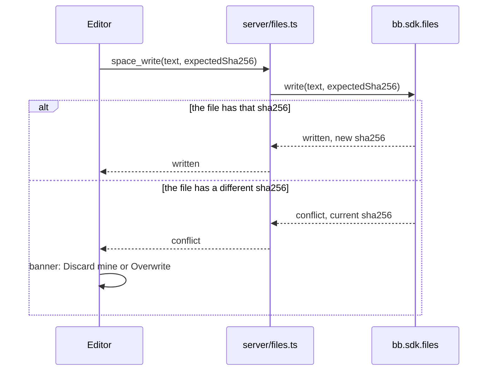
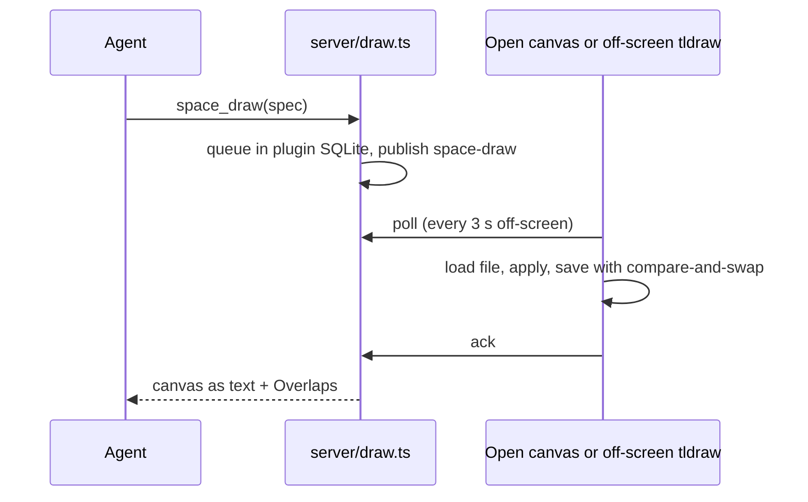
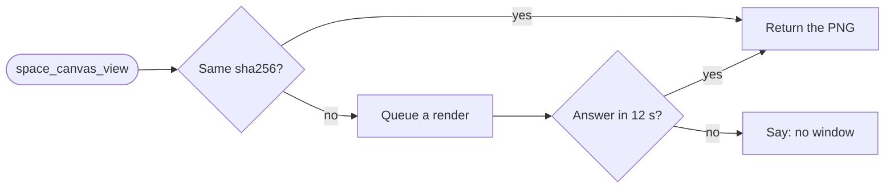
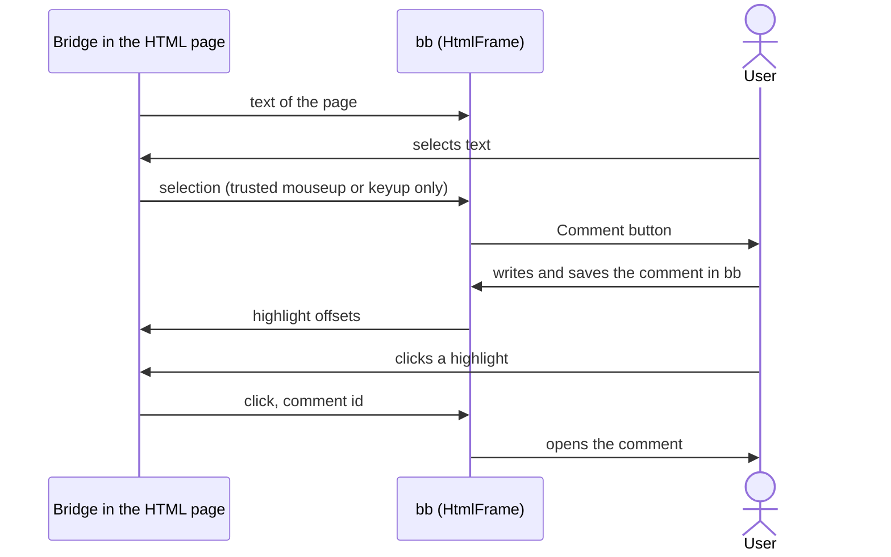

# Architecture

The plugin has three parts: a view in the bb app, server modules behind one
RPC contract, and the `.bb-space/` folder. All file I/O goes through `bb.sdk.files`. ***Thus a project on an
enrolled machine works the same as a local project.***

## How the parts connect

The [architecture canvas](diagram.tldr) shows the parts. The sections below
follow the same order. A blue box is a part of this plugin. A green ellipse
is a place where data is kept. A grey box is outside the plugin.

> [!TIP] Drawn with the plugin itself
> We drew the canvas with `space_draw`. To print it as text, run
> `bb space canvas architecture/diagram.tldr`.

## Space screen

The Space screen owns the route `/plugins/project-space/space/*`. The first
segment is the project id, and the rest is the file path. The Files, Outline
and Review tabs in the right panel get the same `subPath`. Thus the screen
and the tabs agree without shared state.

| File | Job |
| --- | --- |
| [`app.tsx`](../../app.tsx) | registers the screen (`navPanel`), the Files, Outline and Review tabs, the button in the thread header and the `::space` directive |
| [`ui/page/routing.ts`](../../ui/page/routing.ts) | route ⇄ `subPath`, navigation, the tree position setting |
| [`ui/page/SpacePage.tsx`](../../ui/page/SpacePage.tsx) | the project fallback and *Create space* |
| [`ui/page/ProjectSpace.tsx`](../../ui/page/ProjectSpace.tsx) | selects the view for the open file and sets the layout |
| [`ui/page/TextDocument.tsx`](../../ui/page/TextDocument.tsx) | shows and edits text, with compare-and-swap saves |
| [`ui/page/MarkdownEditor.tsx`](../../ui/page/MarkdownEditor.tsx) | the TipTap WYSIWYG editor; its schema is in `markdown-extensions.ts` |
| [`ui/MarkdownView.tsx`](../../ui/MarkdownView.tsx) | the reader: links, `MermaidBlock.tsx`, plugins in `markdown-plugins.ts` |
| [`ui/reading-style.ts`](../../ui/reading-style.ts) | the *Reading style* setting; the CSS is in `ui/reading-styles/` |
| [`ui/page/HtmlFrame.tsx`](../../ui/page/HtmlFrame.tsx) | HTML in a sandboxed iframe; comments in *Annotate* mode are in `ui/annotate/html.tsx` ([annotations](annotations.md#html-pages)) |
| [`ui/TldrawView.tsx`](../../ui/TldrawView.tsx) | `.tldr` canvases with autosave; comments on shapes are in `ui/annotate/tldraw.tsx` ([annotations](annotations.md#canvases)) |
| [`ui/FileTree.tsx`](../../ui/FileTree.tsx) | the tree; `tree-move.ts` for drag and drop; `SearchBox.tsx` |
| [`ui/OutlineTab.tsx`](../../ui/OutlineTab.tsx) | the headings of the open page (`outline.ts`) |
| [`ui/ReviewTab.tsx`](../../ui/ReviewTab.tsx) | the comments of the project and *Send to…*; see [annotations](annotations.md#review-and-send-to) |
| [`ui/page/WorktreeBadge.tsx`](../../ui/page/WorktreeBadge.tsx) | changes in worktrees; `WorktreeDocument.tsx` opens them read-only |
| [`ui/data.ts`](../../ui/data.ts) | RPC hooks that fetch again on `space-changed` |

The other files in `ui/page/` are `Toolbar.tsx`, `BinaryDocument.tsx`,
`ProjectPicker.tsx`, `ProjectSwitcher.tsx` and `FilesTab.tsx`.

### Saving

Each save is a *compare-and-swap* on the sha256 of the file. The editor sends
the sha256 that it started from. If the file on disk has a different sha256,
someone wrote the file in the meantime. Usually this is an agent.

*Overwrite* writes again without `expectedSha256`.

A canvas saves 800 ms after the last edit, with one save at a time. If
nothing is unsaved, the canvas loads outside changes. During a save, an
outside change waits for the answer to the save. Until then, the canvas
cannot know if the change is its own write or a write from an agent.

If a text file is not UTF-8, the server returns it in base64.
`BinaryDocument.tsx` then shows a notice, not the base64 text. Thus no save
can write the base64 over the file.

> [!WARNING] A canvas that tldraw cannot load is read-only
> It opens and shows the reason. Nothing saves over it until someone repairs
> the file on disk: not the user, not `space_draw` and not a renderer.

## Server modules

[`server/index.ts`](../../server/index.ts) defines the settings, makes a
shared context and lists the modules. Each module (`defineModule` in
[`server/context.ts`](../../server/context.ts)) owns an RPC contract, its
handlers and its `bb space` subcommands, if any. The contracts merge into one
`rpcContract`, and the app types its client with it.
[`server/cli.ts`](../../server/cli.ts) merges the subcommands. ==To add a
feature, add a module and one entry in `modules`.== The steps are in
[Develop the plugin → Add a feature](../guides/developing.md#add-a-feature).

| Module | Owns |
| --- | --- |
| [`space.ts`](../../server/space.ts) | project → default source (`hostId` and checkout path), the watcher, the shared zod path schemas |
| [`files.ts`](../../server/files.ts) | the `space_*` file RPC and `bb space root`, `init`, `tree` |
| [`draw.ts`](../../server/draw.ts) | the drawing queue, `space_draw` and `space_canvas_read`, `bb space draw` and `canvas` |
| [`canvas-image.ts`](../../server/canvas-image.ts) | `space_canvas_view` and `bb space canvas --png` |
| [`annotations.ts`](../../server/annotations.ts) | the storage of annotations and the `annotations_*` RPC; see [annotations](annotations.md) |
| [`send.ts`](../../server/send.ts) | `annotations_send` and the `message.dispatch` hook that marks review comments sent |
| [`search.ts`](../../server/search.ts) | `space_search` and `bb space search`; the matching is pure, in `lib/search.ts` |
| [`worktrees.ts`](../../server/worktrees.ts) | `space_worktrees`, `space_worktree_read` and `space_worktree_copy`; see the [storage decision](../decisions/storage.md) |
| [`watch-tree.ts`](../../server/watch-tree.ts) | the watcher for each folder, for live updates |
| [`cli.ts`](../../server/cli.ts) | `bb space`, `link`, and the helpers `projectOption`, `requireProject` and `readInvokerFile` |

### Live updates

If the project's host is the server machine, the server watches *each
folder* of `.bb-space/`. On a change, it publishes `space-changed`, with a
debounce of 250 ms. For a project on another machine, the app polls every
5 s while it is visible.

> [!NOTE] Why not `recursive: true`
> On Linux, the recursive watch of Node follows each file. It loses a file
> that a rename replaced, and editors and agents save files that way.

## Off-screen tldraw: agent drawing

An agent sends a spec of boxes and arrows (`space_draw` or `bb space draw`).
tldraw runs only in the browser, so the server queues the batch and a
browser applies it:

1. If the canvas is open, it applies the batch immediately, saves and sends
   the ack.
2. If not, an off-screen editor in each bb window
   ([`ui/headless.tsx`](../../ui/headless.tsx)) polls the queue and applies
   the batch.
3. The tool waits for the ack for **12 s** or less. Then it returns the
   canvas as text ([`lib/canvas/read.ts`](../../lib/canvas/read.ts)), with the
   user's comments under their shapes. The text ends with an *Overlaps*
   section from [`lib/canvas/lint.ts`](../../lib/canvas/lint.ts).

The shape ids come from the spec ids (`shape:node-<id>`). Thus, if you send a
node again, the node changes in place, and a batch applied twice gives the
same result. The editors run without a current tldraw user, and saves drop
the `user` records ([`ui/canvas-file.ts`](../../ui/canvas-file.ts)). Thus a
canvas that you open in a new browser does not change its file.

## Plugin SQLite: canvas pictures

`space_canvas_view` and `bb space canvas <path> --png <out>` give an agent a
PNG of a canvas as the user sees it. The PNG has the light theme and is
1600 px wide or less. After each save, each renderer posts a PNG
([`ui/canvas-image.ts`](../../ui/canvas-image.ts)). The open canvas and the
off-screen editor are both renderers. The plugin keeps the PNG in its SQLite
database with the sha256 of the file.

- **Old picture** — if the sha256 is not the same as the file, the plugin
  asks for a new picture.
- **No window open** — the call says so in 12 s or less. It does not wait
  forever.
- **Storage** — pictures never go into `.bb-space/`. The plugin deletes
  pictures that did not change for 30 days.

## `.bb-space/` and the path rules

[`lib/`](../../lib/space.ts) is pure code that the server and the app share.
It has no SDK imports and no Node imports. `lib/space.ts` holds the path
rules:

- normalization: no `..` and no absolute paths;
- file kinds;
- link resolution, also for links out of the space to checkout files.

The other files in `lib/` are `annotations.ts`, `callouts.ts`, `search.ts`,
`worktrees.ts` and `canvas/` (draw spec, layout, read and lint).

The tree does not show files and folders whose name starts with a dot.
`.bb-space/.space/` is for the plugin's own data ([annotations](annotations.md)).
[File formats](file-formats.md) tells what each file type opens as.

## File preview URL: HTML and images

HTML and images load from `bb.sdk.files.createPreview`. This gives a
temporary URL with the shape of a path, limited to the space. Thus relative
assets load.

> [!CAUTION] Do not add `allow-same-origin` to the iframe sandbox
> HTML pages can run scripts, but they must not reach bb. Comments on HTML
> pages use `postMessage`. They never touch the DOM of the frame.

The plain view loads the preview URL directly. Two views render the file
through `srcdoc`, with `<base href>` set to the folder of the file on the
preview URL. Thus relative assets still load. These views are:

- the edit preview, which shows the unsaved draft;
- *Annotate* mode, which shows the saved file with the bridge.

### The annotation bridge

In *Annotate* mode, [`html-bridge.ts`](../../ui/annotate/html-bridge.ts) adds
a small script at the top of `<head>`. **The bridge only reports and
paints. Nothing that the page sends can write an annotation.**

| Direction | Message | Meaning |
| --- | --- | --- |
| page → bb | `text` | the rendered text of the page, again after each change |
| page → bb | `selection` / `unselect` | the user's selection as `{ exact, prefix, suffix, rect }`, or that it is gone |
| page → bb | `click` | the user clicked a highlight (or bb revealed it): open the comment `id` |
| bb → page | `highlight` | paint these `{ id, start, end, state }` offsets into the last `text` |
| bb → page | `reveal` / `unselect` | scroll to a highlight; clear the selection after a save |

The code checks each of these security rules:

- **Source** — bb accepts a message only if `event.source` is the
  `contentWindow` of that frame. The bridge accepts messages only from
  `window.parent`.
- **Token** — each message to bb has a random token, new for each mount. The
  bridge runs before the scripts of the page. It keeps the token in a
  closure and removes its own `<script>`, so the page cannot read the token.
- **Schema** — `parseBridgeMessage` checks the channel, the token and the
  shape with zod: finite rects, `ann_` ids, quotes of 4000 characters or
  fewer.
- **Trusted input** — the bridge reports a selection only on a `mouseup` or
  `keyup` where `isTrusted` is true. A page script that selects text and
  dispatches events gets nothing.
- **Gesture in bb** — a selection only shows *Comment*. To make a comment,
  the user must click that button, then type and save in bb's own popover.
  A page cannot click or type into the document of bb.

The page can read what bb sends to it: the ids and offsets of its own
comments. It never gets the text of the comments.
