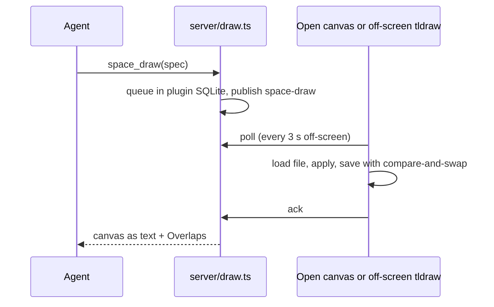

# Architecture

The plugin is a full-screen page in the bb app, a set of server modules
behind one RPC contract, and the `.bb-space/` folder they both work on. All
file I/O goes through `bb.sdk.files`, so ***a project on an enrolled machine
works the same as a local one.***

## How the parts connect

The [architecture canvas](diagram.tldr) shows the parts in the order the
sections below follow. Blue boxes are this plugin, green ellipses are where
data lives, grey boxes are outside the plugin.

> [!TIP] Drawn with the plugin itself
> The canvas was drawn with `space_draw`; `bb space canvas architecture/diagram.tldr`
> reads it back as text.

## Space page

The page owns the route `/plugins/project-space/space/*`: the first segment
is the project id, the rest is the file path. The Files, Outline and Review tabs in
the right panel get the same `subPath`, so page and tree agree without shared
state.

| File | Job |
| --- | --- |
| [`app.tsx`](../../app.tsx) | registers the page (`navPanel`), the Files, Outline and Review tabs, the thread-header button and the `::space` directive |
| [`ui/page/routing.ts`](../../ui/page/routing.ts) | route ⇄ `subPath`, navigation, tree-position setting |
| [`ui/page/SpacePage.tsx`](../../ui/page/SpacePage.tsx) | project fallback and *Create space* |
| [`ui/page/ProjectSpace.tsx`](../../ui/page/ProjectSpace.tsx) | picks the document view and lays it out |
| [`ui/page/TextDocument.tsx`](../../ui/page/TextDocument.tsx) | view and edit with compare-and-swap saves |
| [`ui/page/MarkdownEditor.tsx`](../../ui/page/MarkdownEditor.tsx) | TipTap WYSIWYG; schema in `markdown-extensions.ts` |
| [`ui/MarkdownView.tsx`](../../ui/MarkdownView.tsx) | the reader: links, `MermaidBlock.tsx`, plugins in `markdown-plugins.ts` |
| [`ui/reading-style.ts`](../../ui/reading-style.ts) | the *Reading style* setting; CSS in `ui/reading-styles/` |
| [`ui/page/HtmlFrame.tsx`](../../ui/page/HtmlFrame.tsx) | HTML in a sandboxed iframe |
| [`ui/TldrawView.tsx`](../../ui/TldrawView.tsx) | `.tldr` canvases with autosave |
| [`ui/FileTree.tsx`](../../ui/FileTree.tsx) | the tree; `tree-move.ts` for drag and drop, `SearchBox.tsx` |
| [`ui/OutlineTab.tsx`](../../ui/OutlineTab.tsx) | headings of the open page (`outline.ts`) |
| [`ui/ReviewTab.tsx`](../../ui/ReviewTab.tsx) | the project's annotations and *Send to…* — see [annotations](annotations.md#review-and-send-to) |
| [`ui/page/WorktreeBadge.tsx`](../../ui/page/WorktreeBadge.tsx) | worktree changes; `WorktreeDocument.tsx` opens them read-only |
| [`ui/data.ts`](../../ui/data.ts) | RPC hooks that refetch on `space-changed` |

`Toolbar.tsx`, `BinaryDocument.tsx`, `ProjectPicker.tsx`,
`ProjectSwitcher.tsx` and `FilesTab.tsx` in `ui/page/` fill in the rest.

### Saving

Every save is a *compare-and-swap* on the sha256 the editor started from. A
mismatch means someone, usually an agent, wrote the file meanwhile, and the
editor offers *Discard mine* or *Overwrite*. Canvases autosave 800 ms after
the last edit, one save at a time, and reload on outside changes when nothing
is unsaved. While a save is on its way an outside change waits for its answer:
until then the board cannot tell its own write echoing back from an agent's.

A file that should be text but is not UTF-8 comes back base64-encoded;
`BinaryDocument.tsx` shows a notice for it rather than the base64, which an
edit would save over the file.

> [!WARNING] A canvas tldraw cannot load is read-only
> It opens with the reason shown, and nothing — the user, `space_draw`, a
> renderer — saves over it until the file is fixed on disk.

## Server modules

[`server/index.ts`](../../server/index.ts) defines the settings, builds a
shared context and lists the modules. Each module (`defineModule` in
[`server/context.ts`](../../server/context.ts)) owns an RPC contract, its
handlers and optional `bb space` subcommands. The contracts merge into one
`rpcContract` the app types its client with; [`server/cli.ts`](../../server/cli.ts)
merges the subcommands. ==Adding a feature is a new module plus one entry in
`modules`.==

| Module | Owns |
| --- | --- |
| [`space.ts`](../../server/space.ts) | project → default source (`hostId` + checkout path), the watcher, shared zod path schemas |
| [`files.ts`](../../server/files.ts) | the `space_*` file RPC and `bb space root`, `init`, `tree` |
| [`draw.ts`](../../server/draw.ts) | the drawing queue, `space_draw` / `space_canvas_read`, `bb space draw` and `canvas` |
| [`canvas-image.ts`](../../server/canvas-image.ts) | `space_canvas_view` and `bb space canvas --png` |
| [`annotations.ts`](../../server/annotations.ts) | annotation storage and `annotations_*` RPC — see [annotations](annotations.md) |
| [`send.ts`](../../server/send.ts) | `annotations_send` and the `message.dispatch` hook that marks review comments sent |
| [`search.ts`](../../server/search.ts) | `space_search` and `bb space search`; matching is pure, in `lib/search.ts` |
| [`worktrees.ts`](../../server/worktrees.ts) | `space_worktrees` / `space_worktree_read` — see the [storage decision](../decisions/storage.md) |
| [`watch-tree.ts`](../../server/watch-tree.ts) | the per-directory watcher behind live updates |
| [`cli.ts`](../../server/cli.ts) | `bb space`, `link`, and the helpers `projectOption`, `requireProject`, `readInvokerFile` |

### Live updates

When the project's host is the server machine, a watch on *every directory*
of `.bb-space/` publishes `space-changed`, debounced 250 ms. Otherwise the app
polls every 5 s while visible.

> [!NOTE] Why not `recursive: true`
> On Linux, Node's recursive watch follows files one by one and loses any
> file replaced by rename — which is how editors and agents save.

## Off-screen tldraw: agent drawing

Agents send a boxes-and-arrows spec (`space_draw` or `bb space draw`), but
tldraw runs only in the browser. The server queues the batch and a browser
applies it:

1. If the canvas is open, it applies the batch at once, saves and acks.
2. Otherwise every bb window keeps an off-screen editor
   ([`ui/headless.tsx`](../../ui/headless.tsx)) that polls the queue.
3. The tool waits up to **12 s** for the ack and answers with the canvas as
   text ([`lib/canvas/read.ts`](../../lib/canvas/read.ts)), ending with an
   *Overlaps* section from [`lib/canvas/lint.ts`](../../lib/canvas/lint.ts).

Shape ids derive from spec ids (`shape:node-<id>`), so re-sending a node
updates it and a double apply converges. Editors run without a current tldraw
user and saves drop `user` records ([`ui/canvas-file.ts`](../../ui/canvas-file.ts)),
so opening a canvas in a new browser never rewrites the file.

## Plugin SQLite: canvas pictures

`space_canvas_view` and `bb space canvas <path> --png <out>` give an agent a
PNG of a canvas as the user sees it: light theme, at most 1600 px wide. Every
renderer, open or off-screen, posts a PNG after each save
([`ui/canvas-image.ts`](../../ui/canvas-image.ts)), stored in the plugin's
SQLite tagged with the file's sha.

- **Stale picture** — a sha that no longer matches the file is re-rendered on
  request.
- **No window open** — the call says so within 12 s instead of hanging.
- **Storage** — pictures never go into `.bb-space/`; ones not refreshed for
  30 days are pruned.

## `.bb-space/` and the path rules

[`lib/`](../../lib/space.ts) is pure code shared by both sides, with no SDK
or Node imports. `lib/space.ts` holds the path rules: normalization (no `..`,
no absolute paths), file kinds, and link resolution, including links out of
the space to checkout files. Next to it: `annotations.ts`, `callouts.ts`,
`search.ts`, `worktrees.ts`, and `canvas/` (draw spec, layout, read, lint).

Dot-prefixed files and folders are hidden from the tree; `.bb-space/.space/`
is reserved for the plugin's bookkeeping ([annotations](annotations.md)).
What each file type opens as is in [file formats](file-formats.md).

## File preview URL: HTML and images

HTML and images load from `bb.sdk.files.createPreview` — a temporary,
path-shaped URL confined to the space, so relative assets resolve.

> [!CAUTION] Keep the iframe sandbox without `allow-same-origin`
> HTML pages run scripts but cannot reach bb. Annotating HTML (T34) has to
> work through `postMessage`, not by touching the frame's DOM.
