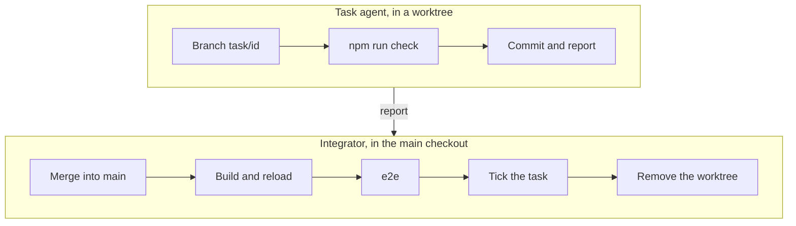

# Develop the plugin

This guide tells you how to prove that a change works. It also tells you how
several agents work on the plugin at the same time. ***Each change must pass
`npm run check`. A UI change must also pass `npm run e2e` against the
installed plugin.***

## Prove a change

Before you start, make sure that you have:

- Node and npm;
- bb, which must run;
- this repository as the **main checkout**, which the installed plugin uses.

1. Install the dependencies:

   ```sh
   npm install
   ```

2. Do the typecheck, run the unit tests and build the plugin:

   ```sh
   npm run check
   ```

3. Load the build into bb:

   ```sh
   bb plugin build && bb plugin reload project-space
   ```

   > [!CAUTION] Do not install or reload from a worktree
   > The installed plugin uses the main checkout. A reload from a worktree
   > replaces the plugin for all other agents.

4. Run the browser checks against the installed plugin:

   ```sh
   npm run e2e
   ```

5. Make sure that the checks passed. Each script prints an `ok` line for each
   check. At the first failure, the script stops with a non-zero exit code.
   Screenshots go to `scripts/e2e/out/`, which git ignores.

| Script | Does |
| --- | --- |
| `npm run check` | `typecheck` + `test` + `bb plugin build` |
| `npm test` | runs only the unit tests (vitest) |
| `npm run coverage` | runs the unit tests and measures the line coverage of `lib/`; the HTML report goes to `coverage/` |
| `npm run e2e` | runs all scripts in `scripts/e2e/`, one after the other |

## Unit tests

The unit tests are `test/*.test.ts`, one file for each module that they test.
They test pure `lib/` code directly. Server handlers run on
`createFakePluginHost`, and the tests stub only the `bb.sdk` calls that the
handler makes. **Keep the line coverage of `lib/` above 80 %.** Today it is
98 %.

| File | Tests |
| --- | --- |
| `space.test.ts`, `links.test.ts` | `lib/space.ts`: path normalization, link resolution (in the space, out to checkout files, `#L` hashes), file kinds, names |
| `callouts.test.ts` | `lib/callouts.ts`: GitHub and Obsidian markers, fold and title, unknown types, markers written back |
| `canvas-layout.test.ts` | `lib/canvas/layout.ts`: box sizes, `lr` and `tb` layers, cycles, anchors, title position |
| `canvas-read.test.ts` | `lib/canvas/read.ts` against `test/fixtures/diagram.tldr`; empty and broken files; comments under their shapes |
| `canvas-spec.test.ts` | `lib/canvas/spec.ts`: colors, shapes, size limits |
| `canvas-lint.test.ts` | `lib/canvas/lint.ts`: shapes that overlap, labels that do not fit |
| `canvas-image.test.ts` | `server/canvas-image.ts`: `space_canvas_view` and `bb space canvas --png` |
| `annotations.test.ts` | `lib/annotations.ts`: `quoteSelector`, `locateQuote` (exact and fuzzy) |
| `html-bridge.test.ts` | `ui/annotate/html-bridge.ts`: the messages that bb accepts (token, channel, schema); the injection into `<head>`; the bridge as a standalone script; untrusted selections and clicks; text from a page that changes all the time |
| `annotate-text.test.ts` | `ui/annotate/text.ts`: the rendered text, selections to offsets and back, the `<mark>` fallback |
| `annotations-store.test.ts` | `server/annotations.ts`: storage, conflicts, moves and removes; a missing file reads as no comments, other read errors are reported |
| `annotations-agent.test.ts` | `lib/annotation-text.ts` and `server/annotations-agent.ts`: `bb space annotations` and `space_annotations` with output below 64 KB; `bb space canvas` and `space_canvas_read` with comments |
| `review.test.ts` | `lib/review.ts`: the review message, the order of the Review tab, ids read back from a message |
| `send.test.ts` | `server/send.ts`: `annotations_send` and the `message.dispatch` hook that marks comments sent |
| `files-rpc.test.ts` | `space_write` and `space_read` on the SDK's fake host, with `bb.sdk.files` over a Map: conflicts, refused paths |
| `search.test.ts` | `lib/search.ts`: text and canvas matches, snippets, which files it reads; `headingAtLine` |
| `outline.test.ts` | `ui/outline.ts`: headings, and ids that match the rendered page |
| `tree-move.test.ts` | `ui/tree-move.ts`: permitted moves; the open document follows them |
| `markdown-roundtrip.test.ts` | the TipTap schema (`ui/page/markdown-extensions.ts`): Markdown in, the same Markdown out, for each page of this space |
| `watch-tree.test.ts` | `server/watch-tree.ts`: new folders, and files that a rename replaced |
| `worktrees.test.ts` | `lib/worktrees.ts` and `?env=` in the route; the copy summary |
| `worktrees-rpc.test.ts` | `space_worktrees` and `space_worktree_copy` on the fake host: "main changed it too", a copy, a refused copy when one side changed |

> [!NOTE] The canvas fixture is a snapshot
> `test/fixtures/diagram.tldr` is an old copy of the architecture diagram. If
> a test needs a new kind of shape, edit the fixture, not the live diagram.

## End-to-end checks

`npm run e2e` controls a real bb server with Playwright. Thus the installed
plugin must be the version that you want to test. The scripts make only
`scratch-e2e*` files in the space. They delete these files at the end, also
after a failure.

| Script | Proves |
| --- | --- |
| `smoke.mjs` | `index.md`, an HTML report and a canvas open without page errors; the canvas file does not change when it opens |
| `live-refresh.mjs` | text added to a page on disk appears without a reload |
| `draw.mjs` | `bb space draw` works with the canvas closed and with the canvas open |
| `annotations.mjs` | the `annotations_*` RPC: create, list, update; annotations follow `space_move` and go with `space_remove` (no browser) |
| `annotations-markdown.mjs` | a selected phrase gets a comment and a highlight; the highlight stays after a reload and after an edit moves it; a click edits and resolves; <kbd>Esc</kbd> while you edit keeps the card open; a deleted phrase shows as orphaned under the title; edit mode has no *Comment* |
| `annotations-canvas.mjs` | two selected boxes get a comment and a badge on their top-right corner; the badge stays after a reload; `bb space canvas` prints the comment under the node; the badge and the Review tab open it; the badge moves with the boxes; the context menu has *Comment*; deleted boxes make the comment orphaned, also for agents |
| `annotations-html.mjs` | on `reports/status.html` in *Annotate* mode: the page's script runs; forged messages and script selections get no *Comment*; a heading selected with a triple-click gets a comment, and its highlight stays after a reload; a click and the Review tab open it; with *Annotate* off, the frame shows the plain preview URL |
| `markdown-editor.mjs` | in the WYSIWYG editor, a changed table cell, a ticked task and a new link are saved to disk; *Source* shows the same text |
| `mermaid.mjs` | two diagrams and one parse error render in light and dark, and render again when the theme changes |
| `formatting.mjs` | callouts (one of them foldable), highlights, `<kbd>`, `<mark>`, `<details>` and footnotes render; the reader drops `<script>`; the editor keeps all of them on save |
| `tree-dnd.mjs` | drag and drop and *Move to…* in the tree; the open document follows; the tree refuses illegal drops |
| `draw-lint.mjs` | a draw with overlaps ends with an *Overlaps* section and the hint for a fix; a clean draw reports none |
| `review.mjs` | the Review tab lists two comments and the open count; a click opens the page at one comment; *Send to → New thread* puts the review message into the composer. If `REVIEW_THREAD_ID` is set, the script sends to that thread, and the tab shows the comments as sent without a reload |
| `annotations-agent.mjs` | a comment made over RPC shows in `bb space annotations list`; `show` prints the quote with three lines on each side; a `reply` and a `resolve` show in the open Review tab without a reload |
| `outline.mjs` | the Outline tab lists the headings; a click scrolls; the highlight moves when you scroll; a canvas has no outline |
| `search.mjs` | `bb space search` finds by name, text and canvas label; the search box replaces the tree; <kbd>Esc</kbd> clears; <kbd>Enter</kbd> opens; a text hit scrolls to its section |
| `outside-links.mjs` | a link out of the space opens the checkout file at its line or range; a link out of the checkout is plain text |
| `canvas-view.mjs` | `bb space canvas --png` directly after a draw shows the new drawing, off-screen and open; a file edited by hand gets a new picture, not an old one |
| `canvas-readonly.mjs` | a canvas that tldraw cannot load is read-only, and nothing saves over it; after a repair of the file, you can edit it again |
| `worktrees.mjs` | a page added in the `.bb-space` of a worktree shows in the badge, opens read-only, and goes away after a delete; **Copy to main space** copies a page; a page that main changed too is marked and copies only after a second click; the script skips this check if there is no worktree |
| `tree-rename-delete.mjs` | a rename of the open page or its folder keeps the page open; the tree refuses a rename onto a name that exists; a delete of the open page or its folder opens the start page |
| `tree-left.mjs` | *File tree position* = `left`: the tree is next to the document; open and make files there; a canvas fills the column; the switch back is live, and the script restores the setting |
| `space-links.mjs` | the **Space** button in the thread header, with a label and as an icon only; the newest `::space` card in a thread and its *Open in space* (the script skips this check if the thread has no card) |
| `edit-conflict.mjs` | a page that changed on disk during an edit: the banner, a refused *Save*, *Discard mine* and *Overwrite*, in WYSIWYG and in *Source* |
| `canvas-conflict.mjs` | an agent changes an open canvas: *Load theirs*, *Keep mine*, a change during a save, and the canvas's own save that comes back as an event |
| `odd-files.mjs` | non-UTF-8 and binary files get a notice and do not change; a NUL in a `.txt`; an image; a 5 MB page; empty folders |
| `console-warnings.mjs` | no bb DOM-guard warning ("tried to move … out of React's tree") names the plugin |

The scripts read their target from these environment variables:

| Variable | Default |
| --- | --- |
| `BB_URL` | `http://127.0.0.1:38886` |
| `PROJECT_ID` | `$BB_PROJECT_ID` (bb sets it in a thread) |
| `CHROME_PATH` | the Chromium of Playwright (`npx playwright install chromium`) |
| `THREAD_ID` | `$BB_THREAD_ID`; if not set, the newest thread of the project (`space-links.mjs`) |
| `CARD_THREAD_ID` | `THREAD_ID`: the thread whose `::space` card the script opens |

[`scripts/e2e/lib.mjs`](../../scripts/e2e/lib.mjs) has two helpers:

- `run(body, cleanup)` runs the cleanup also when `fail()` stops the body.
- `showFiles(page)` shows the Files tab again, because bb opens the tab that
  was open last.

> [!WARNING] Run these scripts only when nobody uses the space
> `tree-left.mjs` changes the *File tree position* setting for all bb
> windows. `bb space draw` with no open window queues a drawing. The drawing
> lands when a bb window opens next.

## Finish a task

The work is cut into [task briefs](../tasks/index.md). An agent does a task
in one of two modes. To see which mode applies, run `bb status`:

| Environment in `bb status` | Mode |
| --- | --- |
| *Project checkout* | the usual mode: work on `main` in the main checkout |
| a worktree | a wave: work on `task/<id>`; see [Run a wave in worktrees](#run-a-wave-in-worktrees) |

In the usual mode, ***a task is done only when it is one commit on `main`
and the plugin that runs in bb is that commit.*** Do these steps in order:

1. Check the change:

   ```sh
   npm run check
   ```

2. Load the build into bb:

   ```sh
   bb plugin build && bb plugin reload project-space
   ```

3. Run the e2e scripts for the parts that you changed. A UI change adds or
   extends a script.

   ```sh
   node scripts/e2e/<name>.mjs
   ```

4. Tick the task in the [status list](../tasks/index.md#status) and in the
   [roadmap](../roadmap.md). Add a *Result* section to the brief: what you
   built, what you measured, and what you did not check.
5. Commit only your files, with the task id in the subject:

   ```sh
   git add <your files>
   git commit -m "Outline tab (T14)"
   ```

> [!WARNING] Do not use `git add -A` in the main checkout
> Other threads can work in the same checkout. `git add -A` puts their
> unfinished changes into your commit. Do not edit a file while another
> thread edits it.

## Run a wave in worktrees

A wave is a set of tasks that run at the same time. Each task agent works in
its own worktree. The integrator merges the branches in the main checkout.



The task agent does these steps:

1. **Work in your own worktree** on the branch `task/<id>`. Change only the
   files that your brief owns. Keep other changes small and additive, and
   write them in the report.
2. **Check locally** with `npm run check`. A UI task also adds or extends a
   script in `scripts/e2e/` for the feature.
3. **Do not install or reload the plugin.** The installed plugin uses the
   main checkout. A reload from a worktree replaces it for all agents.
4. **Update the docs** that your brief names. ==Do not edit the roadmap or
   the status list.== The integrator ticks the task after the merge.
5. **Commit on your branch and report** what changed, how you checked it,
   and what is not done. For a UI change, add screenshots.

The integrator merges the branches in the order of the waves. After each
merge, the integrator does steps 2–4 of [Finish a task](#finish-a-task) in
the main checkout, then commits. Then the integrator removes the worktree:

1. Delete the branch: `git branch -d task/<id>`.
2. Archive the task thread. When the last thread of a worktree is archived,
   bb removes the worktree after five minutes.

## Add a feature

1. Write a server module with `defineModule` (see
   [`server/context.ts`](../../server/context.ts)). The module holds its RPC
   contract, its handlers and its `bb space` subcommands, if any.
2. Add the module to `modules` in [`server/index.ts`](../../server/index.ts).
   Its contract then joins `rpcContract`, and the app types its client from
   that contract.
3. Put pure logic in `lib/`. Test it in `test/<module>.test.ts`.
4. For a UI change, add or extend a script in `scripts/e2e/`. Add the script
   to the `e2e` script in `package.json`.

## Code style

- Start each file with a short comment. Say what the file is for and why it
  has this shape. In the file, comment only the parts that are not obvious.
- Use strict TypeScript and ESM. UI code imports through the `@/` alias.
- Validate RPC input with zod schemas. The shared path schemas are in
  [`server/space.ts`](../../server/space.ts).
- Follow the UI of the bb host: `components/ui/` and Tailwind classes. Do not
  add a UI library.
- Put new dependencies in `package.json`. In the report or the commit
  message, name each new dependency and the reason for it.

## Update the docs

If a change alters behavior, update the page that describes it in the same
change. Write the page with the rules in
[Simplified Technical English](../decisions/simple-english.md).

| You changed | Update |
| --- | --- |
| what a user sees or does | [Use the space](using-the-space.md) |
| a `bb space` command or an agent tool | [For agents](for-agents.md) **and** `skills/project-space/SKILL.md` |
| a module, a data flow or the storage | [Architecture](../architecture/index.md), and its diagram with `space_draw` |
| a file type or Markdown syntax | [File formats](../architecture/file-formats.md) |
| a test or an e2e script | the tables on this page |
| a choice between two approaches | a page in [decisions](../decisions/index.md): Decision, Why, Rejected, Consequences |
