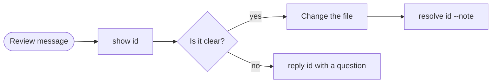

# For agents

This page lists what an agent can do with the space of a project: the
`bb space` commands, the agent tools and the rules for pages. The plugin
gives agents these rules in the `project-space` skill
([SKILL.md](../../skills/project-space/SKILL.md)). This page is the short
version.

> [!IMPORTANT] Write at the path that `bb space root` prints
> Use your usual file tools at that path. In a worktree, the path is in the
> main checkout, so the user sees your changes immediately.

## Commands

| Command | Does |
| --- | --- |
| `bb space root` | prints the absolute path of the live space; makes nothing |
| `bb space init` | makes the space with an `index.md` if it is missing |
| `bb space tree` | lists the files of the space |
| `bb space search <text>` | finds pages by name, then by the text in them |
| `bb space link <path> --title "…"` | prints a `::space` directive, which shows the page as a card in chat |
| `bb space draw <path.tldr> --spec-file spec.json` | draws a diagram of boxes and arrows |
| `bb space canvas <path.tldr>` | prints a canvas as text, with the user's comments under their shapes |
| `bb space canvas <path.tldr> --png /tmp/d.png` | saves a PNG of the canvas as the user sees it |
| `bb space annotations list [--path p] [--status open\|sent\|resolved]` | lists the user's comments, one line each with its `ann_…` id |
| `bb space annotations show <id>` | prints one comment with its quote and 3 lines of the file around it |
| `bb space annotations resolve <id> --note "…"` | marks the comment as done; the Review tab shows the note |
| `bb space annotations reply <id> "…"` | answers and does not resolve, for example to ask a question back |

### Search output

`bb space search` prints the name matches first, one path on each line.
Then it prints the text hits as `path:line: snippet`. A canvas hit gives the
label of the shape and has no line number.

| Limit | Value |
| --- | --- |
| case | ignored |
| hits in each file | 3 |
| results | 50 (`--limit` for fewer) |
| time | about 2 s; then a last line says that the output was cut |
| `--json` | `{ results: [{ path, kind, line?, snippet? }], truncated }` |

> [!TIP] Search before you write
> If a page about the topic exists, extend it. Do not add a second page
> about the same topic.

### Comments from the user

The *Send to…* button of the Review tab posts a message. The message starts
with `Review of the project space`, and each line ends with an `ann_…` id.
The diagram shows what to do with each id.



1. Run `bb space annotations show <id>`. It prints the comment and the
   current position of the quoted text.
2. Change the file.
3. Run `bb space annotations resolve <id> --note "…"`. Write one line about
   the change.

If a comment is not clear, run `bb space annotations reply <id> "…"` with
your question. The comment stays open.

==Each output stays below 60 KB.== If `list` cuts its output, the last line
is `… N more not shown`. Then use `--path` or `--status` to get fewer lines.

A comment on a canvas points at shapes. `bb space canvas <path.tldr>` prints
the comment under the first of these shapes and names the other shapes:

```text
- id "api" [rectangle] "API" at (0, 0) 160x80
    ↳ comment ann_k2… [sent] (also on db): "These two should be one service"
```

A *Comments* section at the end lists the other comments. These are comments
whose shapes are gone, comments on hand-drawn shapes only, and comments on
the whole canvas. It only counts resolved comments. The result of
`space_draw` prints comments in the same way.

## Tools

In new threads, the drawing commands and the comment commands are also
agent tools.

| Tool | Does |
| --- | --- |
| `space_draw` | draws or changes a diagram from a spec; the result ends with an *Overlaps* section for you to repair |
| `space_canvas_read` | prints the canvas as text: nodes, arrows, text, hand-drawn shapes, and comments under their shapes |
| `space_canvas_view` | returns a PNG of the canvas, in the light theme and 1600 px wide or less |
| `space_annotations` | does `action: list \| show \| resolve`, the same as `bb space annotations` |

tldraw runs only in a browser, so an open bb window makes the pictures. Each
save posts a picture. If the picture is old, the window makes a new one on
request. ==If no bb window is open, `space_canvas_view` tells you in 12 s or
less that it cannot make the picture.== Then use `space_canvas_read`. The
plugin keeps pictures in its database, never in `.bb-space/`.

## Rules for pages

- **Front page** — keep `index.md` short. Link each new page from it.
- **Order** — write one topic on each page and put the folders in order by
  topic. Use lowercase-kebab names and relative links between pages.
- **Links to code** — use relative paths here too. From `guides/x.md`,
  `[entry](../../server/index.ts#L10)` (or `#L10-L24`) opens the file in the
  bb preview with these lines highlighted. A link that goes above the
  checkout stays plain text. `/src/app.ts` points to the checkout root, if
  the space has no file at that path.
- **Formats** — use Markdown by default. Use HTML for visual or interactive
  reports. Use `.tldr` canvases for diagrams. Draw them with `space_draw` and
  never write their JSON by hand. Put small diagrams that go with the text
  inline as ` ```mermaid ` blocks.
- **Marks** — each mark is a signal in the reading styles, so give each mark
  one job. Use **bold** for the thing to remember, *italic* for a new term,
  `code` for literal text, and ==highlight== for what changed. Select the
  callout type by what the reader must do. Use tables for items with the
  same attributes. The skill's *Write for a reader* section has all the
  rules.
