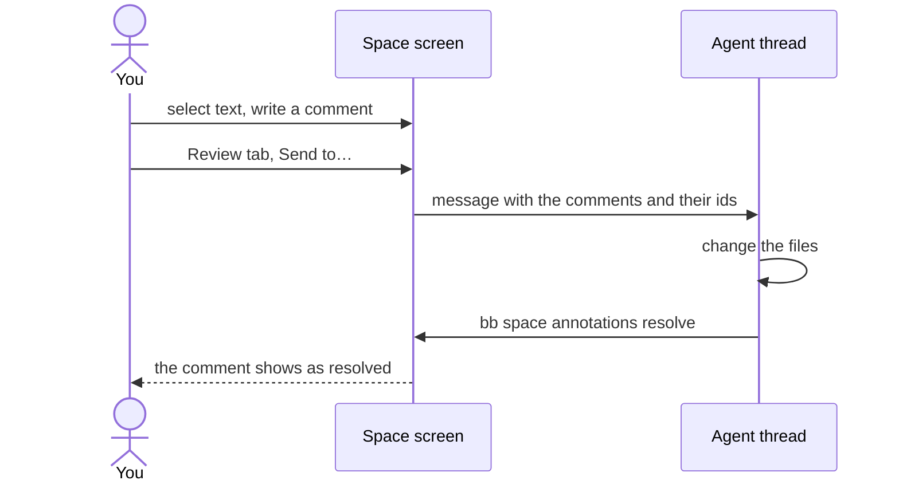
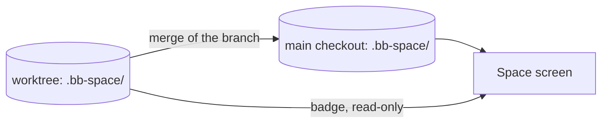

# Use the space

This guide tells you how to open the space of a project, find and arrange
pages, edit them and comment on them. You do all of this on the **Space
screen** in bb. The files are in the `.bb-space/` folder of the project.

## Parts of the Space screen

The sketch shows the Space screen with the right panel open.

```text
┌─────────────────────────────────┬──────────────────────────┐
│ (1) Space      [ project v ]    │ (4) Files Outline Review │
├─────────────────────────────────┼──────────────────────────┤
│ (2) project > page  Edit  (3)   │ (6) [ Search pages... ]  │
├─────────────────────────────────┤                          │
│                                 │   > architecture         │
│ (5) The open file: a page       │   > guides               │
│     or a canvas                 │     index                │
│                                 │     roadmap              │
└─────────────────────────────────┴──────────────────────────┘
```

| No. | Part | Does |
| --- | --- | --- |
| 1 | Title bar | selects the project |
| 2 | Toolbar | shows the path of the open file, **Edit**, **Annotate** on HTML pages, and the worktree badge |
| 3 | Panel button | shows and hides the right panel |
| 4 | Tabs | switch the right panel between **Files**, **Outline** and **Review** |
| 5 | Document | shows the open file |
| 6 | Search box and tree | finds and lists the files of the space |

## Open the space

- In the bb sidebar, click **Space**. It opens the last project that you
  looked at.
- In the header of a thread, click **Space**. It opens the project of that
  thread.
- In chat, an agent can post a `::space` card. Click **Open in space**.

To show a different project, use the selector in the title bar.

## Make, rename and delete files

The **Files** tab in the right panel shows the tree of the space.

1. To make a page, a canvas, an HTML file or a folder, click **+**.
2. To rename or delete a file, move the pointer onto its row. Then click the
   action.
3. To open the `index.md` of a folder, click the folder.

If you rename the open file or its folder, the file stays open with its new
name. If you delete the open file, the start page opens.

> [!TIP] Put the tree on the left
> Set Settings → Plugins → Project Space → *File tree position* to `left`.
> The tree then shows next to the document, not in the right panel.

## Move files

Drag a file or a folder onto a folder to move it there. To move it to the
root of the space, drag it onto the empty area below the tree.

- If you drop an item onto a file, the item moves into the folder of that
  file.
- If you hold an item over a closed folder for a moment, the folder opens.
- If the open file moves, it stays open at its new path.

To move an item with the keyboard, click **Move to…** on its row. Select a
folder with the arrow keys and press <kbd>Enter</kbd>.

> [!NOTE] Moves that the space refuses
> You cannot move a folder into itself. You cannot move an item onto a name
> that is already in the folder.

## Find a page

Type in the **search box** above the tree. The results show while you type:

1. Files with a name that matches. The match is fuzzy.
2. Lines that contain the text, in uppercase or lowercase. Search reads
   Markdown, HTML and other text files, and the labels on canvases.

| Key | Does |
| --- | --- |
| <kbd>↑</kbd> <kbd>↓</kbd> | selects a result |
| <kbd>Enter</kbd> or a click | opens the result; a text hit on a Markdown page scrolls to its section |
| <kbd>Esc</kbd> or × | clears the box and shows the tree again |

Search stops after about 2 seconds or 50 results. If there are more results,
a note tells you. Then make the query more specific.

## Go to a heading

The **Outline** tab lists the headings of the open Markdown page. Click a
heading to scroll to it. When you scroll, the outline highlights the heading
that you read. HTML pages and canvases have no outline.

## Edit a Markdown page

Click **Edit**. You can then change the page directly, and it keeps the look
that it has in the reader.

1. Format the text with the bar above the page. It has bold, italic,
   strikethrough, highlight, code, lists, task lists, quotes, code blocks,
   links and tables. When the cursor is in a table, buttons for rows and
   columns appear.
2. Or type Markdown shortcuts: `## `, `- `, `1. `, `[ ] `, `` ` ``, `**`.
3. To see the raw text with a live preview, click **Source**. To return,
   click it again.
4. To save, click **Save** or press <kbd>Ctrl</kbd>/<kbd>⌘</kbd>+<kbd>S</kbd>.
   Then click **Done**.

You can also tick a task directly on the page.

> [!WARNING] An agent can change the file while you edit it
> If this happens, the save stops and a banner appears. To keep the other
> version, click *Discard mine*. To keep your version, click *Overwrite*. The
> space does not merge the two versions.

### What the editor changes in the source

When you save from the editor, it writes *normalized* Markdown:

- each paragraph on one line;
- `-` for bullets;
- `| --- |` for the rule under a table header.

The page looks the same. Only the layout of the source changes, and only
after you edit the page.

The editor keeps frontmatter and raw HTML as they are. It shows raw HTML as
grey chips. For a callout, edit the body on the page and the
`> [!type] Title` line in *Source*. Footnote references show as small chips,
and the notes stay where you wrote them.

### Links to code

A link can point to a file outside the space, for example
`../../server/index.ts#L10`. Click it to open the file in the bb preview on
the right. The preview highlights the line, or the range for `#L10-L24`.

If a link points above the project checkout, you cannot click it. Move the
pointer onto it to see the reason.

## Comment on a page or a canvas

You can attach comments to text on a Markdown page, to text on an HTML page
and to shapes on a canvas. Then you send them to an agent from the **Review**
tab. The agent changes the files and resolves each comment.



### On a Markdown page

1. Select the text. A **Comment** button appears below the selection.
2. Write the comment. To save it, click **Save** or press
   <kbd>Ctrl</kbd>/<kbd>⌘</kbd>+<kbd>Enter</kbd>. To cancel, press
   <kbd>Esc</kbd>.
3. The text stays highlighted. To read the comment, click the text. You can
   then **Edit**, **Resolve**, **Reopen** or **Delete** the comment.

If you press <kbd>Esc</kbd> while you edit a comment, the edit stops and the
comment stays open.

The highlight follows its text when you or an agent edit the page. This works
while the text stays approximately the same. A resolved comment has an
underline, not a fill.

> [!NOTE] If the text is gone
> If someone deletes the text or changes it too much, the space keeps the
> comment. It shows under the page title as *comment whose text is gone*.
> Click it to edit or delete it.

In edit mode, a selection does not show **Comment**. Click **Done** first.

The space keeps comments in `.bb-space/.space/annotations/`. When you rename
or move a file in the tree, its comments move with it.

### On an HTML page

1. Click **Annotate** in the toolbar.
2. Comment as on a Markdown page: select text, click **Comment** and save.

Highlights show only while **Annotate** is on. Comments whose text is gone
show in a list above the page. In **Annotate** mode, the scripts of the page
still run, and the page still cannot reach bb. If you open a comment from the
**Review** tab, **Annotate** turns on automatically.

### On a canvas

On a canvas, a comment points at shapes, not at text.

1. Select one or more shapes. A **Comment** button appears below the
   selection. You can also right-click the selection and click **Comment**.
2. Write the comment and save it, as on a page.
3. ==A numbered badge appears at the top-right corner of the shapes.== It
   moves with the shapes and with the view. Click it to read, edit, resolve
   or delete the comment. A dashed frame shows the shapes of the comment.

The comment stays on its shapes when you move, resize or restyle them. It
also stays when an agent draws the same node ids again. The badge goes away
only when all its shapes are deleted.

> [!NOTE] If the shapes are gone
> The space keeps the comment. It shows in the top-left corner of the canvas
> as *comment whose shapes are gone*. Click it to edit or delete it. If you
> undo the delete, the badge comes back.

Agents see canvas comments too: `bb space canvas` prints each comment under
its shape.

### Send comments to an agent

The **Review** tab lists the comments of the project by file. Open comments
come first, then sent comments, then resolved comments. Click a comment to
open its file at the comment. A canvas moves its view to the shapes of the
comment.

1. Each open comment has a tick. Remove the tick from each comment that you
   do not want to send.
2. Click **Send to…** and select a destination:

   | Destination | Result |
   | --- | --- |
   | **New thread** | the composer for a new thread opens with the review in it |
   | **Composer on screen** | the review goes into a composer that is open now |
   | **Thread of this project** | the review goes to that thread immediately |

3. The message lists each comment with its quote and its id. It tells the
   agent to resolve each comment with `bb space annotations resolve`.

When the message is sent, the tab marks its comments *sent*, for all three
destinations. The tab updates without a reload. If you do not send a draft,
no comment changes.

> [!NOTE] Check the project of a new thread
> **New thread** opens the composer with the project that it had last.
> Check the project before you send.

## HTML pages and canvases

An HTML file shows as a web page and runs its scripts. It runs in a sandbox
and cannot reach bb.

A canvas is a full tldraw board. It saves 800 ms after your last change. If
tldraw cannot load the file, the canvas opens read-only and shows the
reason. It stays read-only until someone repairs the file.

An agent can change a canvas while you have strokes that are not saved yet.
Then a card appears:

- **Load theirs** — the canvas shows the agent's version, and you lose your
  strokes.
- **Keep mine** — the canvas keeps your strokes, and the agent's version is
  lost.

If a save was in progress, it waits for your answer. Thus you lose nothing
in between.

> [!NOTE] Files that are not UTF-8 text
> A Latin-1 page, or a binary file with a text extension, shows a notice and
> not its content. It has no **Edit** button, so the space never saves over
> it.

## Worktrees

The Space screen shows the space in the **main checkout** of the project. A
thread in a worktree can write into the `.bb-space/` of that worktree. If it
does, a badge appears in the toolbar, for example "1 worktree changed the
space".



1. Click the badge. It lists each worktree with its branch, its threads, and
   the files that it added (**A**), changed (**M**) or deleted (**D**).
2. Click a file. It opens read-only from that worktree, under the banner
   "Viewing branch … — not the main space".
3. To return, click **Open main version**.

> [!IMPORTANT] The space copies nothing into the main space
> The edits arrive when someone merges the branch. The reason is in the
> [storage decision](../decisions/storage.md).

## Settings

Go to Settings → Plugins → Project Space.

| Setting | Values | Does |
| --- | --- | --- |
| *File tree position* | `right` (default), `left` | puts the tree in the right panel, or next to the document |
| *Reading style* | `blue-topaz` (default), `things`, `plain` | sets the look of Markdown pages; see the [decision](../decisions/reading-styles.md) |
| *tldraw license key* | a key, or empty | is necessary only when you open bb at an https address that is not local, for example with bb connect |

The **Blue Topaz** and **Things** themes in Settings → Appearance give agent
replies and file previews the same Markdown look.
