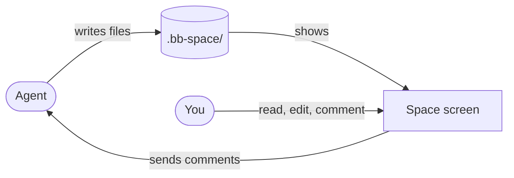

# Project Space

Project Space is a bb plugin. It gives each project a full-screen
documentation **space** with Markdown pages, HTML pages and tldraw canvases.
Agents and people edit these files together. ***The space is the
`.bb-space/` folder in the project checkout, so git keeps it next to the
code.***

> [!NOTE] This space documents the plugin itself
> We write and read these pages with the plugin. Thus each page is also a
> live test of the reader.

## How the space works

An agent writes files into the space. You read and edit them on the Space
screen. Your comments go back to the agent.

## Where to start

| Page | Read it when you want to |
| --- | --- |
| [Use the space](guides/using-the-space.md) | open a space, make pages, edit, search, move files or comment |
| [For agents](guides/for-agents.md) | know the `bb space` commands and the tools that an agent has |
| [Architecture](architecture/index.md) | see how the screen, the server and the files connect |
| [File formats](architecture/file-formats.md) | find what each file type opens as, and the Markdown syntax |
| [Annotations](architecture/annotations.md) | change the comment model, its storage or its RPC |
| [Develop the plugin](guides/developing.md) | run the checks and the e2e scripts, or work in parallel |
| [Decisions](decisions/index.md) | know why something works as it does |
| [Roadmap](roadmap.md) | see what is done and what comes next |
| [Tasks](tasks/index.md) | take a brief that one agent can do alone |
| [Status report](reports/status.html) | see the progress on one visual page |

## Words in this space

Each word below has one meaning on every page.

| Word | Meaning |
| --- | --- |
| *space* | the `.bb-space/` folder of a project and all files in it |
| *Space screen* | the full-screen view in bb that shows a space |
| *page* | a Markdown or HTML file in the space |
| *canvas* | a `.tldr` file, which tldraw opens as a drawing board |
| *comment* | a note that a person attaches to text on a page or to shapes on a canvas |
| *annotation* | the stored record of one comment and its position; the code and `bb space annotations` use this word |
| *main checkout* | the project folder that the installed plugin and the live space use |
| *worktree* | a second checkout of the project for one branch, where a thread can work alone |
| *integrator* | the person or agent that merges task branches into `main` |

## Status

Version `0.1.0`, updated 2026-10-08. The MVP, wave 1 and wave 2 are merged.
The plugin has these parts:

- **Files** — pages and folders, drag and drop, search and an outline.
- **Markdown** — a WYSIWYG editor, callouts, Mermaid and links into the code.
- **HTML** — pages run their scripts in a sandbox.
- **Canvases** — agents draw on them, check them for overlaps and see them
  as PNGs.
- **Comments** — on Markdown pages, HTML pages and canvases. The Review tab
  sends them to a thread, and agents resolve them with
  `bb space annotations`.
- **Other** — live refresh, worktree awareness, unit tests, e2e tests and a
  UI QA sweep.

> [!IMPORTANT] Next
> All planned tasks are merged. One item is open for later: copy the space
> edits of a worktree into the main space. See the [roadmap](roadmap.md).
