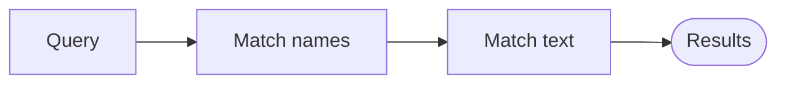

# Project space

Every bb project can have a **space**: the `.bb-space/` folder in the
project's checkout. The user reads it in bb's full-screen **Space** page
(sidebar → Space, or the Space button in a thread header). It renders
Markdown as a document, HTML as a live browser page, and `.tldr` files as a
tldraw canvas. The user edits there too, so treat it as shared, living
documentation — not a scratchpad.

Use it when the user asks you to document, explain, plan, or report on the
project in a way they will come back to. Do not dump session logs here.

## Find it

```sh
bb space root      # absolute path of the live space; creates nothing
bb space init      # create it with a starter index.md if missing
bb space tree      # what is already there
bb space search <text>   # pages by name, then by text inside (canvas labels too)
```

Write with your ordinary file tools at the path `bb space root` prints. In a
worktree, that path is the project's main checkout, so the user sees your
changes immediately; write there rather than into the worktree's own
`.bb-space/` unless the docs must ship on the branch.

## Organize it

- `index.md` is the front page. Keep it short: what the project is, and
  links to the other pages. Update its links when you add a page.
- Group pages in folders by topic (`architecture/`, `guides/`,
  `decisions/`). A folder's `index.md` opens when the folder is selected.
- One topic per page, a clear `# Title` first line, short sections. Prefer
  updating an existing page over adding a near-duplicate.
- Link between pages with relative Markdown links: `[Deploy](../guides/deploy.md)`.
  Images and other assets go next to the page and are linked relatively.
- Link to code the same way, climbing out of `.bb-space/`:
  `[server](../../server/index.ts#L10)` from `guides/x.md` opens the file in
  bb's preview at line 10 (`#L10-L24` highlights a range).
- Names: lowercase-kebab-case (`request-lifecycle.md`).

## Pick the format

- **Markdown (`.md`)** — the default: explanations, guides, decisions.
  GitHub-flavored Markdown (tables, task lists, footnotes, fenced code with
  a language), plus GitHub/Obsidian callouts (`> [!NOTE]`), `==highlight==`,
  and safe inline HTML (`<kbd>`, `<details>`). A fenced ` ```mermaid `
  block renders as a diagram inside the page.
- **HTML (`.html`)** — when the content is visual or interactive: dashboards,
  comparisons, styled reports, small demos. Write a complete, self-contained
  document; relative assets beside it load normally. It runs in a sandbox
  with scripts allowed but no access to bb.
- **tldraw (`.tldr`)** — diagrams: architecture, flows, relationships. Never
  hand-write tldraw JSON; draw with the tool below.

## Write for a reader

The user comes back to these pages weeks later and skims before reading.
The space's reading styles (Blue Topaz by default, Things, or plain) give
headings, bold, italic, highlights, code, callouts, lists and tables each
their own color and shape, so every format is a signal. Use each one for its
one job, and only when the content has that shape — decoration is noise. No
emoji as decoration either: callouts already carry icons.

### Page shape

- `# Title`, then a lead of two or three sentences: what this page covers
  and why it matters. A reader who stops there should still have the point.
- `##` for the sections. They get an underline, colored headings and an entry
  in the Outline tab, so write them as things worth scanning ("Where files
  live", "Why not SQLite"), not "Overview" / "Details". `###` inside a
  section; `####` rarely. Never skip a level.
- Paragraphs of at most four or five sentences. A long run of prose with no
  heading, list, table, code or picture is the cue to restructure.
- Prose for reasoning ("why", trade-offs); do not chop an argument into
  bullets. Structure for things the reader looks up.

Each kind of page has a shape the reader learns to expect:

| Page | Shape |
| --- | --- |
| Guide (how to do X) | lead with the goal; prerequisites as a short list; numbered steps, each with its command in a code block; a last step that shows how to check it worked; pitfalls as `[!WARNING]` callouts at the step they belong to |
| Reference (settings, commands, formats) | one table per group, `code` in the first column; prose only for what the table cannot say |
| Decision | **Decision.** one or two sentences; **Why.** the reasoning in prose; **Rejected.** alternatives as bold-keyword bullets; **Consequences.** When it is superseded: ~~strike~~ the decision and link the new page |
| Architecture | lead, then the diagram, then one `##` section per part in the diagram's order, each linking to its code |
| Plan / roadmap | task lists grouped by `##` milestone; `[!IMPORTANT]` for blockers and open questions |
| Report / status | the verdict first (a `[!NOTE]` or `[!CAUTION]` with the one-line result), then evidence in tables |

### Inline emphasis

| Mark | Job | Use |
| --- | --- | --- |
| `**bold**` | the thing to remember | one or two per paragraph at most; the key term, the decision, the number |
| `*italic*` | a term being introduced, or a nuance | first use of a project term; a soft aside |
| `***bold italic***` | the page's single most important claim | at most once per page (Blue Topaz paints it as a gradient) |
| `==highlight==` | what changed or what to act on | a new value, a renamed thing, the step the reader must not skip; rare, like a marker pen |
| `` `code` `` | anything literal | commands, paths, identifiers, setting names, values — never for emphasis |
| `<kbd>Ctrl</kbd>` | a key to press | shortcuts in guides: `<kbd>Ctrl</kbd>+<kbd>S</kbd>` |
| `~~strike~~` | superseded, kept for history | old decisions and plans, followed by what replaced them |

Bolding whole sentences or every other phrase erases the signal. Meaning must
survive the *plain* style too: color only reinforces what the mark already says.

### Callouts, lists and tables

- **Callouts** are colored boxes with an icon and a title. Pick the type by
  what the reader should do:

  | Type | Color | For |
  | --- | --- | --- |
  | `[!NOTE]` | blue | context worth knowing; a TL;DR under the lead |
  | `[!TIP]` | green | a better way, a shortcut |
  | `[!IMPORTANT]` | violet | something needed to succeed; an open question (`[!question]`) |
  | `[!WARNING]` | orange | a trap that costs time |
  | `[!CAUTION]` | red | data loss, security, irreversible actions |

  ```md
  > [!WARNING] Worktrees write elsewhere
  > `bb space root` points at the main checkout, not the worktree.
  ```

  The title after the marker is optional (it defaults to the type) and
  should carry the point. Obsidian types work too (`info`, `todo`,
  `success`, `bug`, `example`, `quote`, …) and fall into those five colors.
  `> [!info]- Title` makes a callout that starts folded, `+` folded open:
  use that for long logs, raw output, or detail most readers skip. At most
  one or two callouts per section, a few lines each; a page of callouts has
  no signal left.
- **Plain blockquote** only for quoting someone (a user's request, an error
  message, a spec). Things sets quotes in italic.
- **Bulleted list** for parallel items in no order. When the reader scans by
  name, lead each item with a bold keyword: `- **Storage** — files live in …`.
- **Numbered list** only when order matters: steps, a sequence of events.
- **Task list** (`- [ ]` / `- [x]`) for open work; tick items as they land
  rather than deleting them (the Things style fades finished ones).
- **Table** when items share two or more attributes: options compared,
  settings reference, commands and what they do. Short cells; `code` in
  cells is fine. A table beats a list of bullets that each repeat
  "X: …, Y: …".
- **Code blocks** always with a language (it labels the block and
  highlights it). Keep them short; link to the source with `#L10-L24` rather
  than pasting a long excerpt.
- **`<details><summary>…</summary>` … `</details>`** for long material that
  is not a callout: a full config, a stack trace. Leave blank lines around
  the Markdown inside it.
- **Footnotes** (`claim[^1]` … `[^1]: source`) for sources and asides that
  would break the sentence; they gather at the end of the page.
- `---` only to set off a major part (an appendix, a changelog); `##`
  headings already separate sections.

### Pictures: Mermaid, tldraw or HTML

A picture earns its place when the reader would otherwise hold a structure
in their head: a flow, a sequence of calls, states, a timeline, how parts
connect. Put it at the top of the section it explains, with one sentence
before it saying what to look at. The text around it still states the point.

| Use | When |
| --- | --- |
| Mermaid block | small (about ten nodes or fewer), tied to the text and changing with it: a sequence of calls, a state machine, a short flow, a timeline (`gantt`), an entity relation |
| tldraw canvas (`.tldr`) | architecture overviews and maps where layout carries meaning, more than about ten nodes, or a diagram the user will rearrange and annotate; link it from the page with a line saying what it shows |
| HTML report | data, dashboards, interactive comparisons |
| table | the "diagram" is really a matrix of items × attributes |

Give shapes and colors one meaning each, and keep it across every diagram in
the project, so a reader who learned one diagram reads the next. Say what
they mean in the sentence before the diagram, or in a legend text on the
canvas. A starting point:

| Thing | tldraw | Mermaid |
| --- | --- | --- |
| a component or service of this project | `rect`, `blue` | `A[Name]` |
| a data store | `ellipse`, `green` | `A[(Name)]` |
| something outside the project (bb, a third-party API) | `rect`, `grey` | `A([Name])` |
| a decision or branch | `diamond`, `yellow` | `A{Name?}` |
| a problem, risk or failure path | `red` / `light-red` | label the edge (`-->|fails|`) |
| a comment on the drawing | `note` | `%%` comment, or the text around it |

Mermaid in the space:

- Follows bb's light/dark theme. Do not set a theme, `%%{init}%%` or
  hard-coded fills; they break in one of the two modes.
- Renders with `securityLevel: "strict"`: no `click` handlers, no HTML in labels.
- Short labels; quote any label with punctuation: `A["bb space draw"]`.
  `flowchart LR` for pipelines, `flowchart TD` for hierarchies,
  `sequenceDiagram` for who-calls-whom.
- A block that fails to parse shows the error and the source in place of the
  diagram; reread the page after writing it.

HTML reports follow the same reading rules (lead, headings, the verdict
first). They are not themed by bb: declare `color-scheme: light dark` and give
colors for both (`@media (prefers-color-scheme: light)`), so the report reads
in either bb theme.

### A page that uses all of it

````md
# Search

Space search finds pages by name first, then by text inside them, canvas
labels included. It answers from disk in about two seconds at most.

> [!TIP]
> Run `bb space search <text>` before writing a page, to extend the one that exists.

## How a query runs

The server walks the space once per query; nothing is indexed.



1. Names match first, case-insensitive.
2. Text hits come next, at most three per file.

## Limits

| Limit | Value |
| --- | --- |
| results | 50 (`--limit` for fewer) |
| time | ~2 s, then a *truncated* line |

> [!WARNING] Binary and very large files are skipped
> Only text files and `.tldr` labels are searched.
````

### Limits

- Raw HTML is sanitized to GitHub's allowlist plus `<mark>`: no `style`,
  `class`, scripts or event handlers. Prefer the Markdown form when there
  is one (`==x==` over `<mark>`). For anything styled, write an HTML page.
- The user edits pages in a WYSIWYG editor that rewrites the source on save
  (one line per paragraph, `-` bullets). Keep meaning in the Markdown, not
  in line breaks or spacing.

## Draw diagrams

Use the `space_draw` tool (or `bb space draw <path.tldr> --spec-file spec.json`
when the tool is not available). The spec:

```json
{
  "clear": true,
  "layout": "tb",
  "texts": [{ "id": "title", "text": "Request lifecycle", "size": "xl" }],
  "nodes": [
    { "id": "api", "label": "API gateway", "color": "blue" },
    { "id": "db", "label": "Postgres", "shape": "ellipse", "color": "green" }
  ],
  "edges": [{ "from": "api", "to": "db", "label": "SQL" }]
}
```

- Node ids are stable handles: re-sending an id updates that node in place.
  A batch with only new ids lands below the existing drawing — pass
  `clear: true` to replace a diagram instead.
- Omit `x`/`y` for auto-layout (`lr` or `tb`). Edges that skip a layer can
  cut through boxes; for a diagram people will keep, give every node `x`, `y`,
  `w`, `h` on a grid (rows ~300 apart, columns ~550 apart) with
  `layout: "none"`.
- Keep a diagram to about a dozen nodes; split bigger ones into several files.
- Colors: black, grey, violet, light-violet, blue, light-blue, green,
  light-green, yellow, orange, red, light-red. Shapes: rect, ellipse, diamond,
  note.
- The result ends with an *Overlaps* section: shape pairs that sit on top of
  each other and boxes whose label did not fit. Fix them before moving on —
  re-send those node ids with explicit `x`/`y` (and `w`/`h`), or redraw with
  `clear: true`.
- `space_draw` refuses a canvas file tldraw cannot load rather than draw over
  it; fix the file (it is often a bad hand edit or merge), delete it, or draw
  into a new path.
- The result text describes the canvas afterwards. Before changing a diagram
  the user may have edited, read it with `space_canvas_read`
  (`bb space canvas <path.tldr>`). The user's comments on shapes appear
  under the shape they point at (`↳ comment ann_… [open]: "…"`); keep those
  node ids when you redraw, or the comments lose their shapes.
- Link the diagram from the relevant Markdown page.
- To look at the result, call `space_canvas_view` (or
  `bb space canvas <path.tldr> --png /tmp/canvas.png`): a PNG of the canvas as
  the user sees it, rendered by an open bb window. With no window open it says
  so within about 12 s; fall back to `space_canvas_read`. Never save the PNG
  into `.bb-space/`.

## When the user sends annotations

The user comments on passages and canvas shapes in the Space page and sends
them from its Review tab. The message starts with
`Review of the project space` and ends each line with an `ann_…` id. Work
through them one at a time:

1. **Read** — `space_annotations` with `action: "show"` (or
   `bb space annotations show <id>`) prints the comment, any earlier reply,
   and the quoted passage with 3 lines of the file *as it reads now*, the
   quote's lines marked `>` and numbered. The message's quote may be stale;
   trust `show`.
2. **Change the file** — at the path `bb space root` prints, with your
   ordinary file tools.
3. **Resolve** — `action: "resolve"` with a one-line `note` (or
   `bb space annotations resolve <id> --note "…"`) saying what changed. The
   user sees the note in the Review tab at once.

- If a comment is unclear, answer instead of guessing:
  `bb space annotations reply <id> "…"` keeps it open with your question.
- `show` says when a quote is *orphaned* (no longer in the file); check
  whether someone already changed that text before acting.
- A comment on a canvas points at shapes, not text: read the canvas with
  `space_canvas_read` (`bb space canvas <path.tldr>`), which prints each
  comment under its shape, then change the diagram with `space_draw`.
- `bb space annotations list --status open` (or `action: "list"`) shows what
  is still open; `--path` narrows it to one file. Output stays under 60 KB
  and says when lines were cut.

## Point the user at a page

After writing, show the page as a card in chat with the directive
`bb space link <path>` prints, on its own line:

```md
::space{project="proj_…" path="architecture/overview.md" title="Architecture overview"}
```
